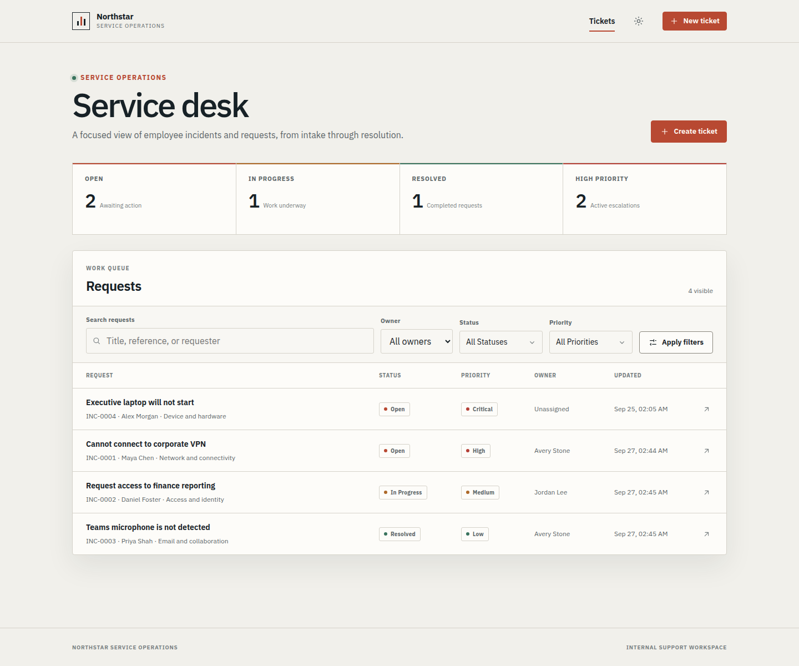

# AI-native SDLC / AI 原生软件交付图解指南

**English and Chinese, with matching chapters. / 中英文两套，章节一一对应。**

This guide explains how to conduct AI-native software delivery using the
repository's actual examples, not an imaginary all-green project. Start with
the overview; use the workshop chapter to present or reproduce the process.
No new documentation server, account, or paid model call is needed to read it.
GitHub renders these Markdown pages, diagrams and screenshots.

本指南用仓库已经执行过的案例，讲解 AI 原生软件交付应该怎样进行，而不是
展示一条虚构的“全绿流水线”。初次阅读从第 1 章开始；演示或动手实践从
第 6 章选择路线。阅读无需启动新网站、配置账号或调用付费模型，可直接在
GitHub 页面或支持 Markdown 的编辑器中阅读。

| Chapter / 章节 | English | 中文 | What you will learn / 学习目标 |
|---|---|---|---|
| 1 | [The operating model](en/01-operating-model.md) | [工作方式与全景](zh/01-operating-model.md) | Roles, stages, evidence and limits / 角色、阶段、证据与边界 |
| 2 | [Intent, Spec and Plan](en/02-intent-spec-plan.md) | [从意图到规格与计划](zh/02-intent-spec-plan.md) | Turn ambiguity into reviewed decisions / 把模糊需求变为可审查决策 |
| 3 | [Build and Verify](en/03-build-verify.md) | [构建与验证](zh/03-build-verify.md) | Review tests, code and real failures / 审查测试、代码和真实失败 |
| 4 | [Deploy, Operate and learn](en/04-deploy-operate.md) | [部署、运行与反馈](zh/04-deploy-operate.md) | Accept an artifact, recover, open maintenance / 验收制品、恢复服务、进入维护 |
| 5 | [Change, diagnosis and Agent evaluation](en/05-engineering-judgment.md) | [变更、诊断与 Agent 评估](zh/05-engineering-judgment.md) | Measure correctness and reasoning separately / 分别衡量修复正确性与证据质量 |
| 6 | [Workshop and adoption playbook](en/06-workshop.md) | [演示、实操与团队落地](zh/06-workshop.md) | Ordered page tour, safe commands, team checklist / 页面导览、安全操作和团队检查表 |
| Reference / 附录 | [Evidence and screenshot register](evidence.md) | [证据与截图索引](evidence.md) | Sources, dates, proof limits and accessibility / 来源、日期、证明范围与可访问性 |

## Start with a concrete outcome / 先看具体结果

**Figure A / 图 A:** the earlier ownership demo, captured September 27, 2026.
It shows what users received, not how it was approved or whether a database
write occurred. [Original case study](../brownfield-human-gated-delivery-case-study.md).

这是 2026 年 9 月 27 日早期工单归属案例的界面，展示“交付了什么”，不单独
证明“如何批准”或“数据库是否发生写入”。来源和完整证明链见
[原始案例](../brownfield-human-gated-delivery-case-study.md)。

## Choose a reading path / 选择阅读路线

- **First introduction / 初次了解:** chapters 1 → 2 → 3 → 4.
- **Engineering leadership / 工程负责人:** chapters 1 → 5 → 6, then inspect the
  linked failure evidence / 之后检查链接中的失败证据。
- **Presenter / 演示者:** chapter 6's 60-minute page tour, with chapters 2–5
  available for deeper questions / 使用第 6 章的 60 分钟页面导览。
- **Hands-on operator / 实操者:** chapter 6's isolated-run path, then the
  existing authoritative command guides / 先按第 6 章选择隔离环境，再进入命令参考。

## Evidence boundary / 证据边界

The historical delivery and reliability examples are **development-test**:
real Actions, model calls, tests, images and observations, but scripted
account-owner-authorized decisions rather than independent Human/customer
acceptance. The engineering pilot verified **6/6 repairs but accepted 0/6
complete evidence packages**. No chapter turns these into production
certification, business ROI, or statistically significant Agent rankings.

历史交付和可靠性案例均为 **development-test**：Actions、模型调用、测试、
镜像和观察是真实的，但决策是账号所有者授权的脚本化操作，不是独立人员或
客户验收。工程评估实验为 **6/6 修复通过，0/6 完整证据验收通过**。
本指南不会把它们解释为生产认证、业务 ROI 或有统计显著性的 Agent 排名。

**Guide prepared:** October 12, 2026. The new screenshots show historical
public pages as viewed on that date; the runs occurred earlier. Local runtime
ports were unavailable during documentation work. No new delivery or paid
experiment was executed to create this guide.

**编写日期：** 2026 年 10 月 12 日。新截图记录这一天看到的历史公开页面，
不代表当天重新执行了演练；编写时旧本地服务端口不可用。编写本指南没有
重新交付应用，也没有执行新的付费模型实验。
