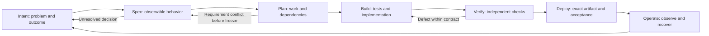

# 1. The operating model: proposals, decisions and evidence

[Guide index](../README.md) · [中文](../zh/01-operating-model.md) ·
[Next: Intent, Spec and Plan](02-intent-spec-plan.md)

## 1.1 What makes this AI-native?

AI-native SDLC means designing the delivery process around AI's ability to
produce and revise useful proposals, **while making decisions, constraints and
verification explicit**. It is not simply enabling autocomplete, nor giving an
agent unrestricted access and treating its final message as completion.

In these examples, AI drafts specifications, plans, tests, implementation and
diagnostic hypotheses. Humans own product choices and risk acceptance.
Deterministic automation validates transitions, enforces approved scope,
executes checks and records identities. Running software supplies observations.
These responsibilities complement one another; none can replace the others.

| Ordinary shortcut | AI-native practice illustrated here |
|---|---|
| Paste a requirement and accept the generated code | Resolve unknowns, approve a versioned contract, then evaluate the implementation |
| Keep decisions only in chat | Bind decisions to question IDs, document versions, source and approval receipts |
| Let the same proposal define success after implementation | Preserve reviewed tests and use independent behavior checks |
| A green check means “done” | Distinguish valid Red, Green, image verification, functional acceptance and evidence acceptance |
| Let automation approve its own output | Separate proposal authority, execution authority and acceptance authority |
| Finish at merge | Verify the exact artifact, observe operation and open new maintenance work |

This is one concrete implementation, not a claim that every team must use
GitHub Issues or test-first development for every change. The portable design
is the **reviewable contract and evidence chain**.

## 1.2 One lifecycle, several feedback loops



The arrows are not permission to rewrite history. Before engineering handoff,
a Spec revision invalidates its approvals and dependent Plan. After the Plan
is fully approved, this repository freezes the contract. A scope change or a
defective frozen harness needs an explicit new Intent/continuation, not a
silent edit to make an existing approval appear valid.

| Stage | Main question | Human responsibility | AI contribution | Evidence required to advance |
|---|---|---|---|---|
| Intent | Why change anything? | Problem, priority, affected users, non-goals | Clarify gaps and alternatives | Real observations or explicitly labelled unknowns |
| Spec | What observable behavior is acceptable? | Decide ambiguity and approve current version | Draft scenarios and map decisions | Resolved/owned questions, acceptance criteria, version/hash |
| Plan | How can this be delivered compatibly? | Check repository facts, risk and dependencies | Propose tasks and verification | Tasks mapped to criteria and approved Spec |
| Build | Does the change respect the contract? | Review tests and code at current heads | Propose tests, then implementation | Controlled Red, preserved tests, focused code |
| Verify | What actually ran and passed? | Interpret coverage and remaining risk | Explain failures, propose corrections | Baseline/feature results, independent checks, failure records |
| Deploy | Is this the artifact we intend to use? | Exercise and accept/reject it | Assist packaging and evidence summaries | Merge SHA, digest, run/attempt, observed behavior |
| Operate | Is service usable, and what should change next? | Own recovery and preventive scope | Correlate evidence, draft maintenance | Probe windows, recovery/data checks, linked follow-up |

## 1.3 Follow the examples without merging their histories

| Example | Teaching role | Observed outcome and boundary |
|---|---|---|
| Earlier ticket ownership case | Visual introduction to the delivered UI | Historical screenshots from a separate completed demo |
| Discovery ownership, [huangyingting/ai-native-sdlc-discovery-demo#1](https://github.com/huangyingting/ai-native-sdlc-discovery-demo/issues/1) | Main Intent → Spec → Plan → engineering story | Four recorded product decisions, Spec v5, reviewed Red/Green, digest acceptance in development-test mode |
| Maintenance [huangyingting/ai-native-sdlc-discovery-demo#8](https://github.com/huangyingting/ai-native-sdlc-discovery-demo/issues/8) → [huangyingting/ai-native-sdlc-discovery-demo#17](https://github.com/huangyingting/ai-native-sdlc-discovery-demo/issues/17) | Learn from operation and failed verification | First attempt cancelled; corrected continuation delivered readiness without erasing failed tests |
| Reliability loops | Test qualification, admission and recovery | Six declared mutants detected; isolated same-image recovery and maintenance follow-up |
| Engineering judgment lab | Change impact, diagnosis and strategy comparison | Proxy change passed 15 legacy + 35 independent checks; all six repairs passed, but exact-evidence gate rejected all six pilot cells |
| Orchestration patterns and Trace Viewer | Inspect actual agent execution and cost structure | Separate demonstrations; not proof that every delivery used multiple agents |

The source repo keeps an **ownership-free service desk** and a **proxy-free
engineering fixture** so new isolated runs are reproducible. The completed
discovery repo contains the delivered ownership/readiness application.
Do not overwrite one with the other or submit an already-implemented ownership
request to the completed demo.

## 1.4 Know which page has authority

| Page or record | What to do there | What it does not prove |
|---|---|---|
| Parent Intent Issue | Read full Spec/Plan revisions; discuss; submit explicit decisions | A generic “looks good” comment is not a recorded approval |
| Document branch | Inspect versioned Spec, Plan and review state | Existence of a document is not acceptance of its content |
| Tests PR | Inspect assertions and expected failures | Counting tests does not show they reach their meaningful assertions |
| Implementation PR | Compare actual code with frozen contracts | AI's completion summary is not Green |
| Actions | Check jobs, exact source revision and attempt | A screenshot of a green job is not the underlying behavior evidence |
| GHCR/image verification record | Identify the runnable artifact by digest | A tag or artifact ZIP digest is not the container image digest |
| Application queue/detail | Exercise user journeys | A screenshot alone does not prove persistence, no-op writes or migration |
| Run record / read-only replay | Trace identities, approvals and current run state | Replaying evidence is not rerunning or independently approving it |
| Trace Viewer | Inspect model/tool spans, overlap, errors and recorded usage | A visually complex trace is not higher product quality |

An approval must answer **who approved what version, based on which evidence**.
A deployment decision must additionally answer **which artifact and verification
attempt**. Without these bindings, an AI-generated summary can be convincing
while referring to the wrong source, tests or runtime.

## 1.5 A practical definition of done

For a small feature, retain one chain:

```text
Intent and decisions
  -> approved Spec + Plan
  -> reviewed Tests head + observed Red
  -> reviewed implementation head + observed Green
  -> protected merge SHA
  -> verified image digest + Actions run/attempt
  -> scenario observations + authorized acceptance
  -> operational owner + next work if needed
```

Do not add bureaucracy without a purpose. For a low-risk internal change, the
same person may fill several roles under explicit policy. For a high-risk
system, independent review, deployment separation, security evidence and formal
change control may be necessary. **One person or two AI calls are not two
independent Human reviewers.**

### Before moving on

- Can you distinguish a model proposal from a trusted transition?
- Can you locate the actual source/run behind an asserted success?
- Can you name the uncertainty that remains after tests are green?
- Can you explain why this guide's real rehearsals are not production or
  customer-outcome evidence?

[Next: turn an unclear ownership request into decisions and a plan](02-intent-spec-plan.md).
