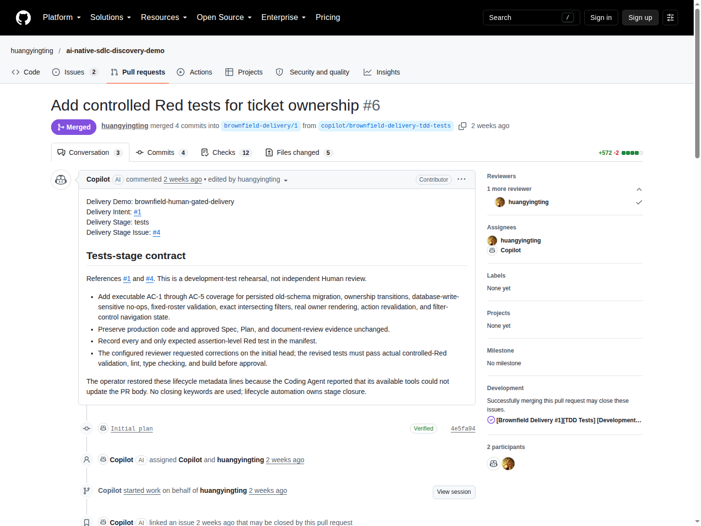

# 3. Build and Verify: make the executable contract trustworthy

[Guide index](../README.md) · [中文](../zh/03-build-verify.md) ·
[Previous](02-intent-spec-plan.md) · [Next: Deploy and Operate](04-deploy-operate.md)

## 3.1 Build starts with a boundary

Once the Plan is fully approved, the repository creates an engineering branch
from the approved document commit. It assigns Tests first, not implementation.
The Tests PR targets that lifecycle branch; the later Implementation PR targets
`main` and carries the complete increment.

[](https://github.com/huangyingting/ai-native-sdlc-discovery-demo/pull/6)

**Figure C.** [huangyingting/ai-native-sdlc-discovery-demo#6](https://github.com/huangyingting/ai-native-sdlc-discovery-demo/pull/6),
viewed October 12, 2026. Identify the target branch, delivery-stage metadata and
scope. Then open **Files changed**, **Checks** and the
[requested-changes review](https://github.com/huangyingting/ai-native-sdlc-discovery-demo/pull/6#pullrequestreview-5333532414).
The screenshot is an entry point, not the complete review or test result.

| Tests stage may | Tests stage must not |
|---|---|
| Add meaningful executable acceptance assertions | Implement production behavior |
| Record the exact observed expected failures | Invent failures before running the suite |
| Correct weak tests before approval | Alter approved Spec/Plan to match easier tests |
| Preserve baseline regression behavior | Call import errors, skipped tests or broken hooks valid Red |

## 3.2 Red tests can produce a green validation job

Controlled Red means:

1. The unmodified baseline passes.
2. New feature tests actually run.
3. They fail for the declared missing behavior, with the expected named failures.
4. Compilation/lint/build are valid and unrelated failures are absent.

The `tdd-red` job checks that contract. Therefore **expected feature tests are
red while `stage-validation` is green**. Approving a failed validator merely
because “we expected Red” confuses the test outcome with the gate outcome.

In the ownership example, corrected
[Red attempt 2](https://github.com/huangyingting/ai-native-sdlc-discovery-demo/actions/runs/36372294023/attempts/2)
verified exactly **10 declared assertion-level failures**. Approval bound
Tests head `108699b7b12673596b04e14074fd84556c81073d`.

## 3.3 Review what assertions prove

The first proposed tests were not accepted immediately. Here is the difference
between a plausible test and a useful one:

| Weak proxy | Stronger required observation |
|---|---|
| Owner names appear in dropdown options | Actual owner text appears in the correct queue row and detail metadata |
| Timestamp did not change | A separate SQLite `PRAGMA data_version` observer sees no write |
| Updating owner returns success | Assign, reassign and clear each persist across close/reopen |
| All records are returned somewhere | Exact combined filter result sets and empty-set cases match |
| HTML contains a selected option | A mounted control synchronizes after real navigation |
| A field can be updated | Only permitted fields change; unrelated rows/fields are preserved |

Use this review question repeatedly: **Could a wrong implementation still pass
this assertion?** If yes, improve the test or state the limitation. Do not
increase test count without improving discriminatory power.

## 3.4 Implementation is evaluated against the approved tests

After reviewed Tests merge, AI proposes the implementation. Reviewers inspect:

- Storage migration, validation and behavior required by the Spec.
- Actual UI/data integration, not only a helper that is never used.
- Byte-preserved approved tests, documents and failure manifest.
- Additional regressions in new files where needed.
- Passing current-head checks and review, not an earlier approved head.

The real [ownership implementation](https://github.com/huangyingting/ai-native-sdlc-discovery-demo/pull/7)
passed Stage Green and application CI: **37 tests, lint, build and container
smoke**. This is that historical increment's count, not the later readiness
application's 50-test count.

| Required surface | What to inspect |
|---|---|
| `stage-validation` | Approved blobs unchanged; formerly expected Red scenarios now Green |
| `validate` | Application tests, lint and build |
| `container-smoke` | Actual production container startup and smoke |
| Delivery policy | Eligible current-head approval, required checks and branch policy |

New commits require renewed applicable review. A successful coordination
workflow is not a substitute for the application checks it coordinates.

## 3.5 The most important counterexample: a flawed frozen harness

The later readiness work demonstrates why Red alone is insufficient.

```text
Missing readiness route
  -> guarded tests fail as expected
  -> Tests approved and frozen
  -> real implementation reaches deeper assertions
  -> harness defects surface
  -> Green fails; implementation is not merged
```

The first maintenance implementation,
[huangyingting/ai-native-sdlc-discovery-demo#14](https://github.com/huangyingting/ai-native-sdlc-discovery-demo/pull/14),
produced **44 passes and four failures**. Two harness problems had been hidden
behind the missing-route guards:

1. A concise `beforeEach` returned a mock function. Vitest treated that returned
   function as cleanup and invoked it.
2. A long-lived SQLite observer retained stale column metadata after another
   connection changed the schema.

The earlier Tests review missed these. The team did **not** add test-aware
production hacks or quietly edit frozen tests. The operator cancelled
[huangyingting/ai-native-sdlc-discovery-demo#8](https://github.com/huangyingting/ai-native-sdlc-discovery-demo/issues/8)
and created the explicit
[continuation](https://github.com/huangyingting/ai-native-sdlc-discovery-demo/issues/17).

Before freezing the continuation's tests, an **isolated harness experiment**
combined the new tests with the prior unmerged route candidate and ran all
48 tests successfully. That experiment exercised deeper assertions; it was
not stage Green and did not place production code in the Tests branch.

Later implementation review found an attempt to sanitize an error by mutating
its properties. Frozen errors could make that operation throw. Two new
supplemental tests reproduced the defect; removing the mutation led to
**50 passing tests** while preserving the approved originals.

This is a disciplined feedback loop, not autonomous perfection.

## 3.6 Qualify the verifier itself

The reliability follow-up asked whether the final readiness tests would detect
specific wrong implementations:

| Deliberate mutation | Why it should be caught |
|---|---|
| Omit the database read | An apparently healthy endpoint may not check the dependency |
| Return 200 on database failure | Admission would accept an unusable instance |
| Omit `no-store` on success or failure | A cached answer could hide current state |
| Log the raw exception | Readiness diagnostics could disclose sensitive details |
| Mutate a caught frozen error | Error handling can introduce a new failure |

In the executed qualification: **13 original tests passed → all six declared
mutants were detected → 13 restored tests passed**. Test blobs stayed unchanged.
The frozen-error mutant has a specifically allowed application TypeError in
known test bodies; it is not falsely described as assertion-only. Import,
hook and timeout errors are not valid kills.

This is six named checks of a narrow contract, **not a project-wide mutation
score**. Read the [qualification evidence](../../brownfield-reliability-rehearsal.md#2-trustworthy-verification)
before generalizing.

## 3.7 A failure-triage decision table

| Observation | Correct next action |
|---|---|
| Dependencies/imports fail before feature assertions | Repair environment/harness; do not record valid Red |
| Code violates approved behavior | Correct code under the same contract; rerun checks |
| Tests are weak before approval | Revise Tests and rerun actual Red |
| Frozen contract or harness is wrong | Use explicit continuation/new work; preserve failed evidence |
| Green passes but coverage misses an important failure | Add independent/supplemental qualification without weakening approved tests |
| Only a model summary says “fixed” | Execute verification before accepting |

### Exit checklist

- [ ] Baseline, actual Red and actual Green are separately identifiable.
- [ ] The approved assertions reached meaningful behavior.
- [ ] Tests and documents were not weakened to obtain Green.
- [ ] Every failure has a cause classification and retained evidence.
- [ ] Current-head code review and required checks are satisfied.
- [ ] Remaining untested behavior is explicit.

[Next: verify the image, accept behavior and close the operational loop](04-deploy-operate.md).
