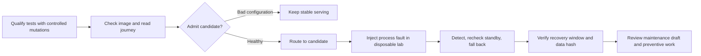

# 4. Deploy, Operate and learn: close the loop beyond merge

[Guide index](../README.md) · [中文](../zh/04-deploy-operate.md) ·
[Previous](03-build-verify.md) · [Next: engineering judgment](05-engineering-judgment.md)

## 4.1 Merge, publication and acceptance are different events

[](https://github.com/huangyingting/ai-native-sdlc-discovery-demo/actions/runs/36381916918/attempts/2)

**Figure D.** The actual readiness publication run, viewed October 12, 2026.
Inspect `publish` and `verify`, then the parent Intent's digest-bound record.
The Artifacts table's SHA-256 identifies a downloadable workflow artifact;
**it is not the GHCR image digest**.

In this repository:

1. Required review and checks permit a protected merge.
2. Publication builds and pushes an image.
3. Verification pulls the exact digest and starts a temporary container.
4. Reviewers exercise the approved behavior against that artifact.
5. Applicable acceptance closes the Intent.

The `it-service-desk-demo` Environment represents temporary container
verification, **not a permanently hosted public application**. An older local
instance is not automatically upgraded by a merge.

Final readiness delivery identity:

| Item | Value |
|---|---|
| Merged application revision | `d361ce032b0f729f62b165c23c4f79bb56f29b92` |
| Publish/verify | Run `36381916918`, attempt `2` |
| GHCR image digest | `sha256:1fab5706994daec051dbd183ea42a23ab0e74e2caeefeef1e48454fe17aaa5bb` |
| Acceptance | [Recorded observations on the continuation Intent](https://github.com/huangyingting/ai-native-sdlc-discovery-demo/issues/17#issuecomment-5864107648) |

The [full image reference and runtime instructions](../../brownfield-discovery-maintenance-rehearsal.md#run-the-published-maintenance-digest-on-a-fresh-workstation)
are in the canonical report. Use a new isolated volume and available loopback
port; do not attach historical accepted data to an experiment.

## 4.2 Exercise a user journey, not just an endpoint

[](../../assets/brownfield-case-study/ticket-detail.png)

**Figure E.** Earlier, separate ownership demo; September 27, 2026. Look at
record metadata and the labelled owner controls. This is not a screenshot
of the later readiness run.

[](../../assets/brownfield-case-study/owner-filter.png)

**Figure F.** Earlier ownership demo's combined filter. The screenshot illustrates
AND semantics; persisted data and navigation still need independent evidence.

For a fresh ownership acceptance:

1. Record the digest and verification attempt before opening the application.
2. Inspect old records and the initial unassigned state.
3. Assign, reassign and clear an owner; compare detail and queue.
4. Reload and restart the same disposable data volume; inspect persistence.
5. Exercise exact filter sets, empty states and navigation.
6. Submit invalid inputs safely in the isolated environment; verify no mutation.
7. Check original create/status/search behavior.
8. Record what was actually observed and what was not tested.

Screenshots document visible states. Tests and read-only database comparisons
establish no-op writes, complete-field preservation and old-schema migration.
Neither source replaces the other.

An eligible reviewer in a **new run** submits:

```text
/sdlc accept sha256:<64hex>
<Actual scenarios, observations, evidence links and limitations.>
```

Reject with `/sdlc reject sha256:<64hex>` and actual failures instead. Replace
placeholders; never accept a digest you did not exercise. For a still-open run,
reverification invalidates earlier acceptance even if the digest is unchanged.
An accepted run is terminal; further delivery uses a new Intent.

The historical examples use scripted, authorized development-test decisions,
not independent Human acceptance.

## 4.3 Observe a gap, then create new work

After ownership delivery, a disposable replica with an invalid database path
returned:

| Request | Observation | Interpretation |
|---|---|---|
| `/api/health` | 200, `{"status":"ok"}` | Process liveness remained true |
| `/` | 500 | The user journey was unusable |
| `/api/ready` | 404 | No dependency-readiness endpoint existed |

This was deliberate fault injection, not a production outage. The prior
delivery verifier also checked the dashboard; it was not shown accepting this
broken replica. Liveness was doing its intended job, but operation needed a
separate readiness signal.

The new requirement became an independent maintenance Intent:

- Keep existing liveness unchanged.
- Check the database on every readiness request.
- Healthy: 200 and exactly `{"status":"ready"}`.
- Unavailable: 503 and exactly `{"status":"unavailable"}`.
- Both responses: `Cache-Control: no-store`.
- Log a fixed generic message rather than paths, exception details or stacks.
- Verify recovery after repair and preserve data.

[](https://github.com/huangyingting/ai-native-sdlc-discovery-demo/issues/17)

**Figure G.** [huangyingting/ai-native-sdlc-discovery-demo#17](https://github.com/huangyingting/ai-native-sdlc-discovery-demo/issues/17)
preserves the cancelled attempt and explains the new contract. It does not
rewrite the accepted ownership story.

The continuation's real acceptance checked healthy readiness, invalid-path
readiness, unchanged liveness, sanitized logs, 50 repeated readiness requests,
full data preservation and same-volume restart. The configuration repair
recreated a disposable instance; it did not edit a running process's environment.

## 4.4 Three small reliability loops



1. **Trustworthy verification:** original/restored 13-test controls and six
   deliberate mutants establish a narrow readiness-test capability.
2. **Safe local admission and recovery:** reject a misconfigured candidate;
   admit a healthy candidate; pause it; recheck stable before fallback.
3. **Operational feedback:** record incident/recovery observations, generate
   an unapproved maintenance draft, review and implement preventive scope,
   repeat relevant checks before closure.

[](https://github.com/huangyingting/ai-native-sdlc-discovery-demo/actions/runs/36388446065)

**Figure H.** Actual [hosted run 36388446065](https://github.com/huangyingting/ai-native-sdlc-discovery-demo/actions/runs/36388446065).
Its summary is a navigation aid. Use the
[measured report](../../brownfield-reliability-rehearsal.md) for proof details.
Artifact retention is finite; visibility in a screenshot does not guarantee a
later download remains available.

Two local repetitions rejected bad configuration, performed exactly one
fallback and passed separate five-sample recovery windows. Observed detection
times were 4,208/4,207 ms and recovery confirmations 733/882 ms. The actual
hosted repetition is recorded separately in the report.

These are short, deliberately faulted **same-image, read-only-gateway exercises**.
They do not establish production MTTR, an SLO, arbitrary write-traffic safety,
cross-version rollback or backup restoration. The data hash comparison covers
the full controlled schema/rows for this scenario only.

## 4.5 Recovery is not preventive closure

Returning traffic to stable answers “is the read journey working again?”
It does not answer “have we prevented recurrence?”

The normal maintenance follow-up
[huangyingting/ai-native-sdlc-discovery-demo#25](https://github.com/huangyingting/ai-native-sdlc-discovery-demo/issues/25)
linked reviewed scope and
[huangyingting/ai-native-sdlc-discovery-demo#26](https://github.com/huangyingting/ai-native-sdlc-discovery-demo/pull/26).
Closure followed an actual post-merge hosted rehearsal, not merely creation of
an AI-generated draft.

For your own team, require an operational owner, observations separated from
hypotheses, proposed prevention, acceptance checks and a post-change result.
If the root cause is unknown, say so. “AI diagnosed it” is not root-cause evidence.

### Exit checklist and production gap

- [ ] Digest, source SHA, run and attempt all refer to the same delivery.
- [ ] User-journey observations accompany smoke verification.
- [ ] Fault drills use isolated resources and checked cleanup.
- [ ] Recovery and preventive completion have separate evidence.
- [ ] Maintenance links back to the observation without rewriting old approvals.

Before production, add the controls appropriate to the system: independent
approvals, signed provenance/admission, authorization/privacy review, capacity
and load tests, cross-version database compatibility, tested backup restoration,
on-call ownership, SLOs and business-outcome measurement. These are **remaining
work**, not capabilities inferred from the screenshots.

[Next: evaluate changes, diagnoses and Agent strategies honestly](05-engineering-judgment.md).
