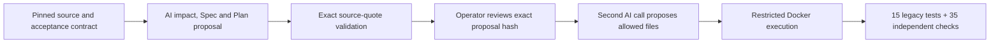

# 5. Change, diagnosis and Agent evaluation

[Guide index](../README.md) · [中文](../zh/05-engineering-judgment.md) ·
[Previous](04-deploy-operate.md) · [Next: workshop](06-workshop.md)

## 5.1 Why a separate engineering lab?

The accepted service desk and its historical contracts must remain intact.
The independent [engineering fixture](../../../demos/engineering-lab/) therefore
provides a dependency-free synthetic Node.js application with its own manifest,
lockfile and tests. [Reusable tooling](../../../tools/engineering-demo/README.md)
runs experiments outside the source checkout.

This is not another live service-desk deployment. The proxy feature exists
only in the verified experiment candidate; the committed fixture deliberately
remains proxy-free so a new experiment can start from the same baseline.

[](https://github.com/huangyingting/ai-native-sdlc-discovery-demo/pull/27)

**Figure I.** [huangyingting/ai-native-sdlc-discovery-demo#27](https://github.com/huangyingting/ai-native-sdlc-discovery-demo/pull/27)
publishes the tooling and actual outcomes, including failure. It is not the
proxy implementation's delivery PR. Read the
[canonical experiment report](../../engineering-judgment-rehearsal.md) for the
measurements, hashes and qualification overhead.

## 5.2 Change-impact loop: a small field can affect four contracts

The request adds a temporary proxy without replacing the accountable owner:

```text
effectiveOwner = proxyOwner ?? owner ?? null
```

The tempting incomplete solution is to add a field to the returned JSON.
The complete change must also preserve storage, filtering and old consumers.

| Surface | Required reasoning | Independent verification |
|---|---|---|
| Domain | Proxy precedence; owner remains accountable; AND filtering | Proxy/fallback/null cases and combined filters |
| Storage | Nullable `proxy_owner`; additive/idempotent migration | Actual old-schema rows, preserved fields, reopen persistence |
| Mutation API | `assignProxy(id, proxyOwner)` validates IDs and owner values | Invalid input does not insert/mutate; null clears |
| Serialization | Preserve original fields; add `proxyOwner` and `effectiveOwner` | Exact field behavior including null |
| Documentation/consumers | Explain semantics and compatibility | Contract update; unchanged legacy tests and consumer behavior |



The actual accepted run produced **20 exact source quotations**, an explicit
hash-bound operator receipt and changes to only four allowed files. All
15 legacy tests and 35 independent checks passed. The receipt says
`independentHumanReview:false`; do not present it as independent approval.

An earlier validator wrongly limited analysis to one quotation per edit file.
The model had correctly cited multiple facts and unchanged consumers.
The fix separated **impact coverage** from **permission to edit**:
analysis can cite supplied consumers without gaining permission to change them.
The rejected attempt was preserved, not rewritten.

**Transferable lesson:** impact analysis should include unchanged contracts
that must survive a change, not only files a model proposes to edit.

## 5.3 Diagnosis: determine which layer is wrong

Three fixed faults are applied independently to fresh identical copies:

| Case | Deliberate fault | Correct response | Wrong shortcut |
|---|---|---|---|
| Product | Owner/status intersection becomes OR | Correct the product predicate | Relax the expected result set |
| Test harness | An expected owner contradicts the unchanged contract | Restore the exact original assertion | Change correct product behavior to satisfy the drifted test |
| Environment | Database path points below `/dev/null` | Correct runtime configuration | Rewrite the store or keep retrying |

The Agent receives real failing output and relevant synthetic files, not the
expected fault label or independent oracle implementation. It must provide a
classification, exact evidence and minimal file changes. The host adapter
restricts paths; generated code executes only in non-root, read-only,
network-disabled, resource-limited Docker, with disposable temporary storage.

The CLI transport is deliberately qualified:

- Structured JSONL preserves exact response content; plain terminal rendering
  had wrapped strings and broken JSON.
- An empty `--available-tools=` did **not** remove tools in the tested CLI.
  Explicit exclusions and observed zero-tool telemetry were required.
- Missing/unexpected telemetry or tool requests cause rejection.
- Docker setup/execution share a deadline; owned cleanup has a separate bound.

These controls constrain an authorized experiment. They are not a formal
sandbox certification or a guarantee that all future CLI versions have no
side effects. Requalify changed tool/event behavior before real use.

## 5.4 Compare strategies, not storytelling

The pilot compared:

- **Direct:** one response containing diagnosis and patch.
- **Diagnose-first:** one diagnostic response, then a fresh response proposing
  the patch using that handoff.

This is not two independent Human reviewers or necessarily two different models.
Both strategies had the same maximum allowance: two calls and 300 seconds
per cell, at most 120 seconds per call. Direct used one; diagnose-first used
two. The six cells therefore used nine planned calls, with alternating order,
the same source/fault/oracle and no automatic retry or human repair.
Equal upper bounds do not imply equal token allocation or actual spending.

| Pilot measure | Direct | Diagnose-first |
|---|---:|---:|
| Cases | 3 | 3 |
| Independently verified repairs | 3/3 | 3/3 |
| Complete evidence acceptance | 0/3 | 0/3 |
| Actual calls | 3 | 6 |
| Input tokens | 24,591 | 50,262 |
| Output tokens | 1,136 | 2,449 |
| Summed cell wall time | 91,865 ms | 155,140 ms |
| Reported premium-request units | 3 | 6 |
| Invoiced dollar cost | Unknown | Unknown |

All six candidates restored the exact baseline and passed **15 visible tests
and 20 independent checks each**, with correct classifications and scope.
But the evidence gate rejected every cell:

- Some quotes normalized Markdown punctuation or newlines.
- Some referenced “Actual failing test output” rather than the validator's
  reserved `test-output` path, which the original prompt had not clearly specified.

The result was **`completed-with-failures`, exit 2**. Current prompts clarify
the evidence protocol; the paid pilot was **not rerun after that correction**.
Do not invent an improved acceptance rate or attribute an underspecified
protocol entirely to model weakness.

Current metrics distinguish:

| Metric | Meaning |
|---|---|
| `repairsVerified` | Behavioral tests and independent oracle passed |
| `evidenceAccepted` | Diagnosis evidence satisfied its contract |
| `unacceptedCompletionClaims` | Claimed completion did not pass the full gate |
| `falseCompletionClaims` | Claimed repairs actually failed behavioral verification |

The original report's broader false-completion label was corrected in tooling
and explained in the historical report, not silently relabelled in old evidence.
**A valid repair with a bad citation is not a false repair claim.**

One trial per three small cases cannot establish a statistically significant
winner. In this pilot diagnose-first consumed more without changing observed
repair outcomes. That is useful local evidence, not a universal rule.

## 5.5 Use traces to understand execution, not to substitute for quality

[](https://huangyingting.github.io/ai-native-sdlc/viewer/?run=36092002982)

**Figure J.** A separate existing
[direct-execution trace](https://huangyingting.github.io/ai-native-sdlc/viewer/?run=36092002982),
captured October 12, 2026. It is not one of the engineering pilot's nine calls.
The viewer's price-based **estimated cost** is not invoiced spend and must not
be substituted for the engineering experiment's unknown dollar cost.

Read the page in this order:

1. Check run identity and observed model, not just requested model.
2. Read the hierarchy: orchestrator, model calls, tools and any subagents.
3. For parallelism, inspect overlapping independent branches, not agent count.
4. Inspect failures in context; a failed tool can be recovered within a successful run.
5. Check actual usage and cache treatment. Cached input is a subset of input,
   not extra input to add again.
6. Ask what product behavior the trace does **not** establish.

The [pattern guide](../../copilot-cli-agent-orchestration-patterns.md) covers
direct execution, parallel delegation, critic-reviser loops and sequential
pipelines. The pictured run illustrates direct execution only. A critic can
challenge assumptions, but an additional AI voice is not automatically
independent evidence.

### A reusable evaluation card

For each future experiment, declare before execution:

- Immutable source, task, allowed changes and hidden/independent checks.
- Strategy and model configuration; observed model after execution.
- Call/time limits, retry rules and human interventions.
- Functional outcome, regression outcome, evidence quality and scope compliance.
- Actual usage, unavailable telemetry, qualification overhead and failures.
- Sample size and what cannot be concluded.

Keep all attempts. Never convert unknown cost to zero, CLI usage units to dollars
without evidence, or repeated attempts into a selectively reported first success.

[Next: teach, reproduce and adopt this process](06-workshop.md).
