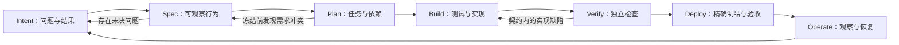

# 1. 工作方式：AI 提议，人做决策，证据决定能否推进

[指南目录](../README.md) · [English](../en/01-operating-model.md) ·
[下一章：Intent、Spec 与 Plan](02-intent-spec-plan.md)

## 1.1 什么才是 AI-native？

AI 原生 SDLC 是围绕 AI 生成、修改方案的能力来设计交付过程，同时把
**决策、约束和验证变成显式机制**。它既不只是打开代码补全，也不是把
无限权限交给 Agent，然后把最后一句“已完成”当成交付结果。

本仓库中，AI 起草规格、计划、测试、实现和诊断假设；人负责产品取舍和风险
接受；确定性的自动化负责校验状态转换、限制范围、执行检查和保存身份信息；
真正运行的软件提供观察结果。这四者互相补充，不能互相替代。

| 常见捷径 | 本指南采用的做法 |
|---|---|
| 粘贴需求，接受生成代码 | 先解决未知项，批准版本化契约，再评价实现 |
| 决策只留在聊天里 | 绑定问题编号、文档版本、源代码与决策凭据 |
| 实现完成后再由同一方案定义“成功” | 保留已审查测试，使用独立行为检查 |
| 一个绿勾就代表完成 | 区分有效 Red、Green、镜像验证、功能验收和证据验收 |
| 自动化批准自己的产物 | 区分提议权限、执行权限和验收权限 |
| 合并就结束 | 验证精确制品，观察运行，再产生新的维护工作 |

这是一种具体实现，不是要求所有团队都使用 GitHub Issues，或所有变更都
必须测试先行。真正可迁移的是 **可审查的契约与完整证据链**。

## 1.2 一条生命周期，多条反馈回路



箭头不是“可以改写历史”的许可。工程交接之前，修改 Spec 会使其批准记录和
依赖它的 Plan 失效。这个仓库在 Plan 完整批准后冻结契约。此后如果范围改变，
或者冻结的测试工具本身有问题，需要明确的新 Intent／延续任务，而不是悄悄
修改文档或测试，让旧批准看起来依然成立。

| 阶段 | 核心问题 | 人的责任 | AI 的贡献 | 推进所需证据 |
|---|---|---|---|---|
| Intent | 为什么值得改？ | 问题、优先级、用户和非目标 | 暴露缺口、提出替代方案 | 真实观察，或明确标注的未知项 |
| Spec | 什么行为算符合预期？ | 决定歧义，批准当前版本 | 起草场景，映射决策 | 已处理／有负责人承担的问题、验收条件、版本及哈希 |
| Plan | 如何兼容地交付？ | 核查仓库事实、风险和依赖 | 拆任务，设计验证 | 与已批准 Spec、验收条件对应的任务 |
| Build | 变更是否遵守契约？ | 审查当前版本的测试和代码 | 先提议测试，再提议实现 | 受控 Red、保留测试、聚焦代码 |
| Verify | 实际运行了什么？ | 判断覆盖范围和剩余风险 | 解释失败，提议修正 | 基线／特性结果、独立检查、失败记录 |
| Deploy | 是我们要使用的制品吗？ | 实际操作并接受／拒绝 | 辅助打包、整理证据 | 合并 SHA、镜像摘要、运行及重试次数、行为观察 |
| Operate | 能否提供服务，下一步改什么？ | 恢复责任、预防性工作范围 | 整理观察、起草维护任务 | 探针窗口、恢复与数据检查、关联后续工作 |

## 1.3 串起案例，但不要混淆不同演练的历史

| 案例 | 教学作用 | 已观察结果与边界 |
|---|---|---|
| 早期工单归属案例 | 先看交付后的 UI | 历史截图来自另一个已完成 demo |
| Discovery 工单归属：[huangyingting/ai-native-sdlc-discovery-demo#1](https://github.com/huangyingting/ai-native-sdlc-discovery-demo/issues/1) | 主线：Intent → Spec → Plan → 工程实现 | 四项产品决策、Spec v5、经审查的 Red／Green、development-test 模式摘要绑定验收 |
| 维护 [huangyingting/ai-native-sdlc-discovery-demo#8](https://github.com/huangyingting/ai-native-sdlc-discovery-demo/issues/8) → [huangyingting/ai-native-sdlc-discovery-demo#17](https://github.com/huangyingting/ai-native-sdlc-discovery-demo/issues/17) | 从运行和失败验证中学习 | 第一次取消，修正后交付 readiness；没有抹去失败测试 |
| 三个可靠性闭环 | 测试可信度、流量准入和恢复 | 六个指定变异被检测；隔离、同镜像恢复及维护跟进 |
| 工程判断实验室 | 变更影响、诊断和策略对比 | 代理负责人变更通过 15 项原测试＋35 项独立检查；六次修复成功，但完整证据全部未获接受 |
| 编排模式与 Trace Viewer | 看清 Agent 的真实执行与成本结构 | 独立示例，不证明每次交付都使用了多 Agent |

源仓库刻意保留 **没有 ownership 的服务台** 和 **没有 proxy 的工程实验基线**，
以便在新环境中重复演练。完成态 discovery 仓库则已经有 ownership／readiness。
不要用其中一个覆盖另一个，也不要对已经具备 ownership 的 demo 重复提交
“首次实现 ownership”的请求。

## 1.4 哪个页面负责什么？

| 页面或记录 | 在这里做什么 | 它不能单独证明什么 |
|---|---|---|
| 父 Intent Issue | 阅读完整 Spec／Plan、讨论、明确记录决策 | 一句“看起来不错”不等于系统已记录批准 |
| 文档分支 | 检查 Spec、Plan 和版本化审查状态 | 文档存在不代表内容被接受 |
| Tests PR | 审查断言和预期失败 | 测试数量不证明运行到关键断言 |
| Implementation PR | 对照冻结契约审查代码 | AI 的完成总结不是 Green |
| Actions | 检查任务、源代码版本、运行和 attempt | 一张绿色截图不是底层行为证据 |
| GHCR／镜像验证记录 | 用 digest 确定实际运行制品 | tag 或下载包摘要不是容器镜像摘要 |
| 工单队列／详情 | 实际操作用户流程 | 截图不单独证明持久化、无写入操作或迁移 |
| 运行记录／只读回放 | 追溯身份、批准和运行状态 | 回放不是重新执行或独立批准 |
| Trace Viewer | 查看模型／工具调用、并发、错误和用量 | 图越复杂不代表产品质量越高 |

批准必须能回答：**谁，基于什么证据，批准了哪个版本？**
交付决定还必须回答：**哪个制品，哪一次验证？**
缺少这些绑定，AI 的总结可能很有说服力，却指向错误的源代码、测试或运行实例。

## 1.5 一个可执行的“完成”定义

对一个小功能，至少保留以下链条：

```text
Intent 和决策
  → 已批准的 Spec + Plan
  → 审查过的 Tests head + 实际 Red
  → 审查过的实现 head + 实际 Green
  → 受保护的合并 SHA
  → 已验证镜像 digest + Actions run/attempt
  → 场景观察 + 有权限的验收
  → 运维负责人 + 必要的后续工作
```

机制要解决具体问题，而不是增加无意义流程。低风险内部变更中，同一个人可以
按明确规则承担多个角色；高风险系统可能需要独立审查、部署职责分离、安全
证据和正式变更控制。**一个人，或两次 AI 调用，都不是两个独立的人类审查者。**

### 阅读检查

- 能否区分模型提议和可信的状态转换？
- 能否找到一次“成功”对应的真实源代码／运行记录？
- 测试全绿后，还有什么不确定性？
- 为什么这些真实演练仍不能证明生产可用性或客户价值？

[下一章：把模糊的工单归属请求变成明确决策和计划](02-intent-spec-plan.md)。
