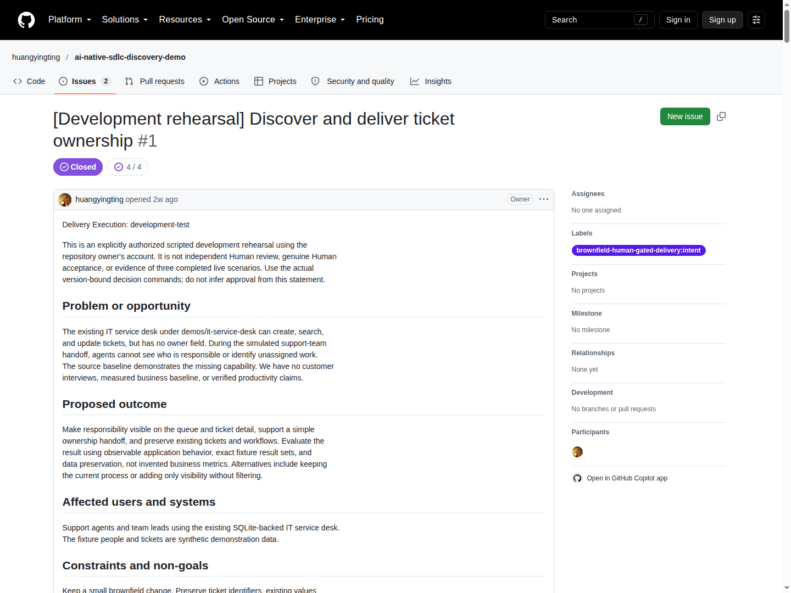
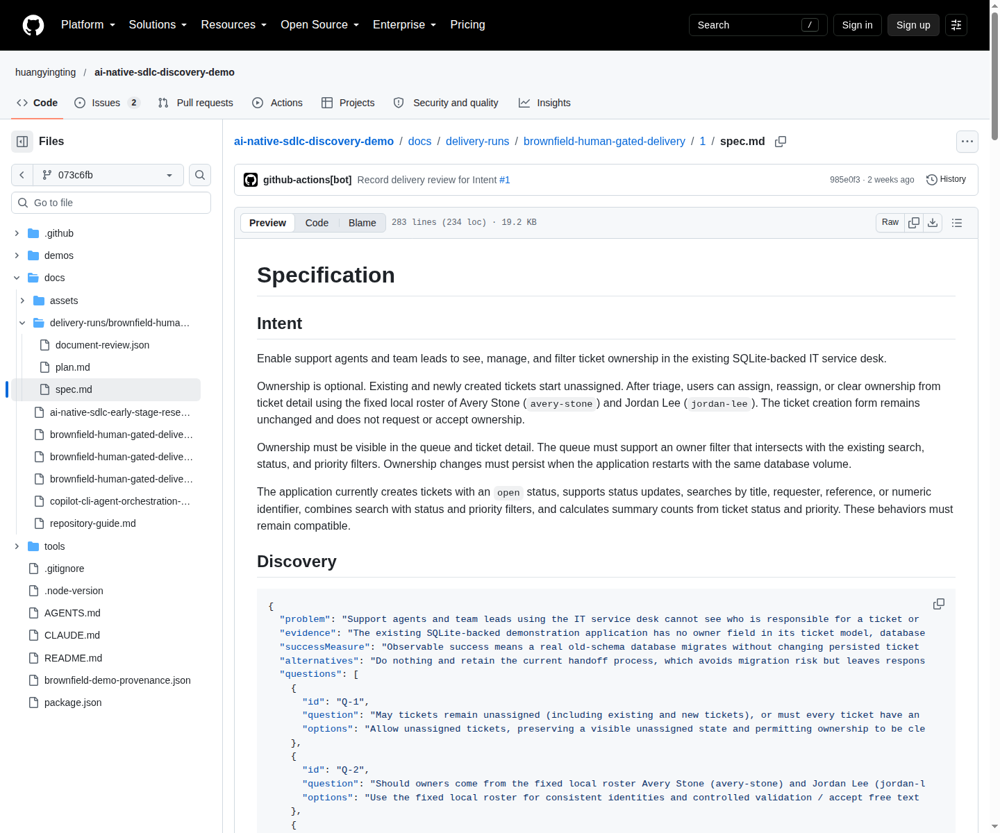
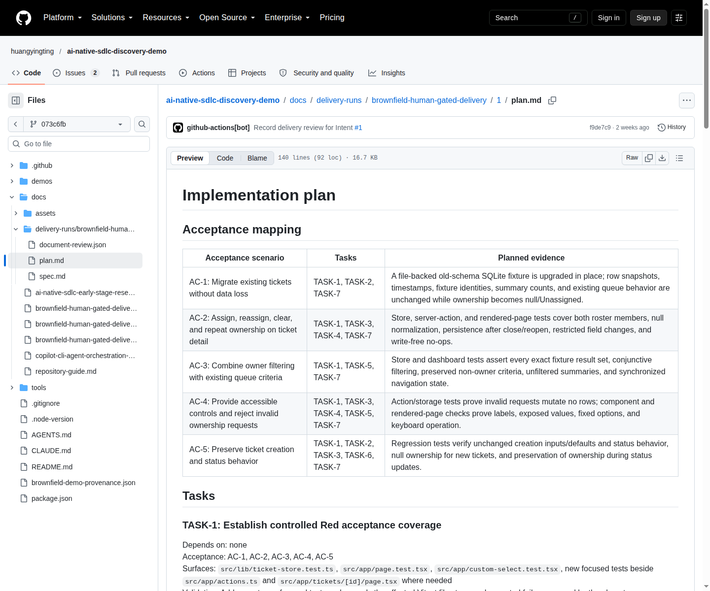

# 2. Intent、Spec 与 Plan：写代码之前先处理不确定性

[指南目录](../README.md) · [English](../en/02-intent-spec-plan.md) ·
[上一章](01-operating-model.md) · [下一章：构建与验证](03-build-verify.md)

## 2.1 从 Intent 页面开始，而不是直接下实现指令

[](https://github.com/huangyingting/ai-native-sdlc-discovery-demo/issues/1)

**图 B。** 2026 年 10 月 12 日查看的历史
[huangyingting/ai-native-sdlc-discovery-demo#1](https://github.com/huangyingting/ai-native-sdlc-discovery-demo/issues/1)。
重点阅读问题和结果；Closed 是历史演练状态，不表示应该在这里重新提交需求。

已有服务台可以创建、查询和更新工单，却不能显示谁负责。一个不充分的请求是：
“加个负责人下拉框。”这在定义责任语义之前，已经选定了 UI 方案。

更好的 Intent 包含：

| 字段 | 工单归属示例 |
|---|---|
| 问题／证据 | 合成交接场景中，无法识别责任人或未分配工作；基线没有 owner 模型 |
| 预期结果 | 责任可见、支持交接、保留已有工作流 |
| 用户 | 支持人员和团队负责人 |
| 约束 | 保留记录及时间戳；控件有标签、可用键盘操作；结果可持久化 |
| 非目标 | 身份认证、外部目录、SLA、通知、批量分配 |
| 未知项 | 负责人必填吗？使用固定名单吗？只展示还是支持筛选？ |
| 成功证据 | 可观察 UI 行为、精确查询结果集、数据保留情况 |

原始 Intent 明确写了“没有客户访谈或生产力指标基线”。不能为了让文档完整，
凭空填写业务收益。真实团队应该附上实际调研和基线；还不知道时，把它变成
发现任务，而不是把假设当成既定收益。

## 2.2 让 AI 暴露选择，不要让它悄悄替人选择

在新配置的演练里，请求人提交 Intent，Kickoff 转交 Documents 工作流，
只读 Copilot CLI 提议 Spec，可信自动化校验并在父 Issue 上发布完整版本。
**此时不需要生产代码、Tests PR 或应用构建。**

Discovery 案例产生了四个阻塞问题：

| 决策 | 为什么重要 | 记录的结果 |
|---|---|---|
| Q-1：可选还是必填 | 影响创建行为与旧工单处理 | 可选；旧／新工单默认未分配 |
| Q-2：身份从哪里来 | 影响校验、持久化和范围 | 固定 Avery／Jordan；空选项对应 null |
| Q-3：只展示还是筛选 | 影响用户旅程与查询语义 | 与已有条件取交集；导航不能保留陈旧选项 |
| Q-4：如果必填，旧数据怎么办 | 条件假设可能不再成立 | “必填”的前提不适用；不虚构历史归属 |

每项决策都会生成新的 Spec。实际演练到达 **Spec v5**，随后是 **Plan v1**。
这是历史结果，不是下一次必须照抄的版本顺序。

[过早批准被拒绝的原始记录](https://github.com/huangyingting/ai-native-sdlc-discovery-demo/issues/1#issuecomment-5862230300)
明确指出：

> Unresolved discovery blockers: Q-1, Q-2, Q-3, Q-4.

这条命令没有创建批准、Plan 或工程分配。机制的价值是 **阻止了不合格的推进**，
而不是“页面上有一个问题列表”。

## 2.3 审查者具体怎么做？

在 **新的隔离演练** 中使用当前 Issue hub，不要操作已经完成的历史 Issue。
以下命令是这个仓库的自定义接口，不是 GitHub 或 Copilot 内置命令。

1. 阅读最新完整 Spec 和 discovery brief。
2. 对照原始问题与仓库事实，检查每个问题。
3. 由配置中有权限的审查者回答当前一个问题：

   ```text
   /sdlc decide spec v1 Q-1
   Outcome: Tickets may remain unassigned until triage.
   Rationale: Requests arrive before a responsible agent is known.
   ```

4. 等待新版本发布；先看这个答案如何进入验收条件，再回答下一个问题。
5. 必须延期的问题，按 [defer 命令参考](../../../tools/brownfield-demo/README.md#spec-readiness-profiles)
   记录理由、负责人、后续工作和风险。“延期”意味着有人承担未知风险，不是已解决。
6. Spec 仍不完整时，提交明确的修改意见。
7. 阻塞项处理后，只批准当前真实版本，例如：

   ```text
   /sdlc approve spec v5
   ```

这里的 `v1`、`Q-1`、`v5` 都是示例，使用你自己的 hub 中的编号。
命令放在新顶层评论第一行，不要连代码围栏一起粘贴，也不要通过编辑旧评论发命令。
普通讨论和 `@copilot` 提及都不是文档批准。

## 2.4 Spec 要可测试，但不必提前决定每个实现细节

[](https://github.com/huangyingting/ai-native-sdlc-discovery-demo/blob/073c6fb0831e38d5513e22ac193a7bdaac2918cf/docs/delivery-runs/brownfield-human-gated-delivery/1/spec.md)

**图 B1。** 不可变提交上的冻结 Spec。将 Intent、Discovery 和验收场景一起阅读。
截图只展示文档顶部，完整已批准内容请打开链接。

以下是对已批准行为的 **教学性重述**，不是替换冻结 Spec：

```text
假如 INC-0001 尚未分配，
当用户在详情页选择允许的本地负责人并保存，
那么详情与队列都展示该负责人，
刷新页面或用相同数据重启后仍保留该分配，
同时工单的无关字段保持不变。
```

还必须包含反例、边界和兼容性：

- 清空归属：存储为 null，界面显示 Unassigned。
- 重复选择同一负责人：证明数据库没有写入，不只是时间戳相等。
- 提交非法负责人或不存在的工单：显式失败并保留数据。
- 负责人、搜索、状态、优先级使用 **AND**，而不是 OR。
- 只清除负责人筛选：保留其他条件，导航返回后控件正确同步。
- 打开旧数据库：增加可空 owner，同时保留旧值。

“筛选正常”不如明确集合有用。Discovery 固定数据中，Avery 对应
`{0001, 0003}`，Jordan 对应 `{0002}`，Unassigned 对应 `{0004}`；
Avery＋open＋high＋`inc-1` 得到 `{0001}`，Avery＋critical 得到空集。
这些结果依赖当时准备的固定数据，不是每个新数据库都天然满足。

## 2.5 Plan 必须建立在仓库事实之上

[](https://github.com/huangyingting/ai-native-sdlc-discovery-demo/blob/073c6fb0831e38d5513e22ac193a7bdaac2918cf/docs/delivery-runs/brownfield-human-gated-delivery/1/plan.md)

**图 B2。** 真实已批准验收映射。沿每一行阅读：条件 → 任务编号 → 计划证据。
计划证据是以后必须履行的要求，不代表检查已经执行。

Plan 是关联已批准 Spec 的实现提议。审查依赖、范围与验证，不只是看任务列表
是否“听起来合理”。

| 示意任务 | 依赖 | 验证方式 |
|---|---|---|
| 增加可空存储与兼容迁移 | 已批准的归属语义 | 旧 schema 行与原字段值 |
| 实现合法交接和无操作行为 | 存储 API | 非法输入、重复负责人、关闭后重开 |
| 队列与详情展示 owner | 存储结果 | 真正的行／详情元数据，不仅是下拉选项 |
| 增加交集筛选和导航同步 | 查询契约 | 精确集合、只清除一个筛选、前进后退 |
| 验证已有创建／状态／搜索 | 完整增量 | 已批准回归测试与镜像 smoke |

这是任务结构示意，不是原 Plan 的任务编号台账。真正的 Plan 中，每个验收
条件都应映射到具体任务和检查。

后来的维护 Plan 曾声称仓库已有公共 HTTP 测试工具。实际检查发现是
直接模块／组件 Vitest 测试，审查者因此
[要求修正](https://github.com/huangyingting/ai-native-sdlc-discovery-demo/issues/8#issuecomment-5863070163)。
这说明“AI 很熟悉仓库的语气”不能代替事实。

用 `/sdlc revise plan` 指出缺失映射或无依据假设。准备好后，批准最新版本，
例如：

```text
/sdlc approve plan v1
```

## 2.6 把批准视为变更边界

Plan 完整批准之前，显式修改 Spec 会使之前的 Spec 批准及关联 Plan 失效。
Plan 完整批准之后，系统冻结 Spec、Plan、审查状态，并且 **只分配 Tests**。
此后范围变化需要新 Intent，不能偷偷放进实现。

Discovery 演练证明了未决问题阻塞和决策驱动修订，**没有**证明已批准 Spec
被撤销：v1–v4 当时没有批准。“显式 Spec 修改”是另一个独立演练场景。

### 阶段退出检查

- [ ] 问题和未知项真实，没有虚构客户证据。
- [ ] 每个阻塞选择都有答案或有负责人承担的延期。
- [ ] 验收包括失败与兼容行为，不只有顺利路径。
- [ ] Plan 假设对应实际仓库位置。
- [ ] 任务映射验收条件和验证，依赖没有环。
- [ ] 审查者理解 Plan 批准后哪些产物将被冻结。

深入阅读：[Discovery 真实证据](../../brownfield-discovery-maintenance-rehearsal.md#2-intent-became-explicit-version-bound-decisions)
与 [操作手册](../../brownfield-human-gated-delivery-walkthrough.md#5-review-and-iterate-on-the-spec)。

[下一章：审查可执行契约和实际实现](03-build-verify.md)。
