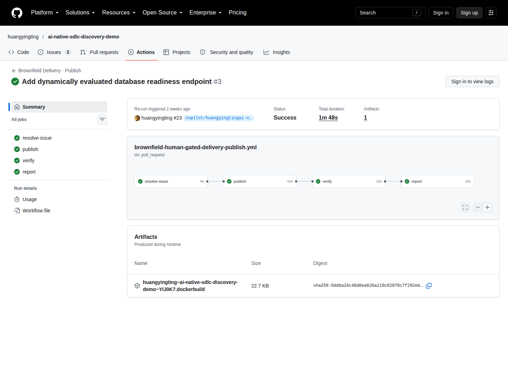
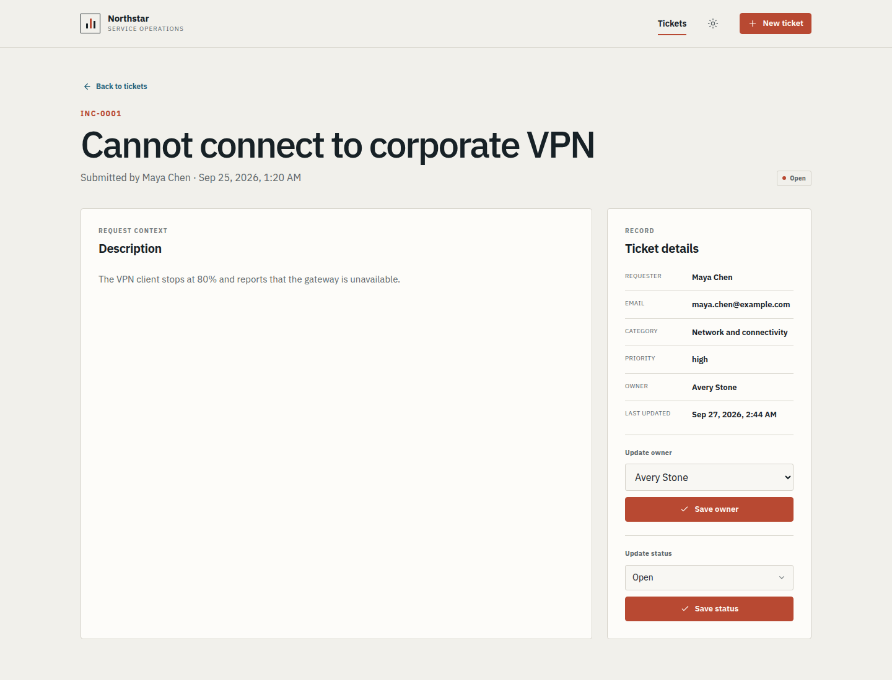
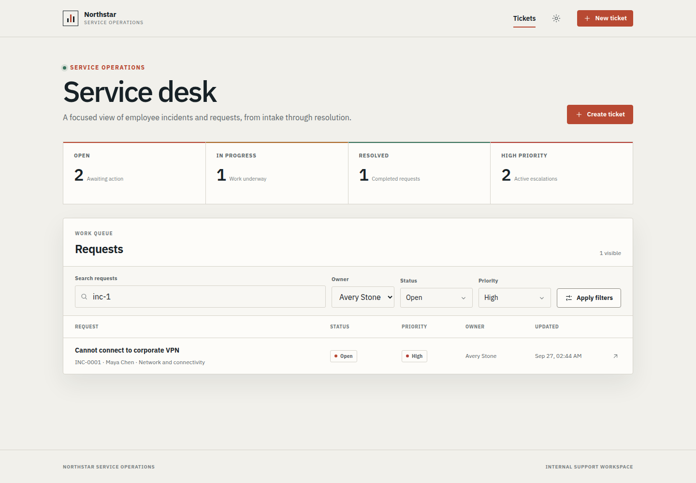
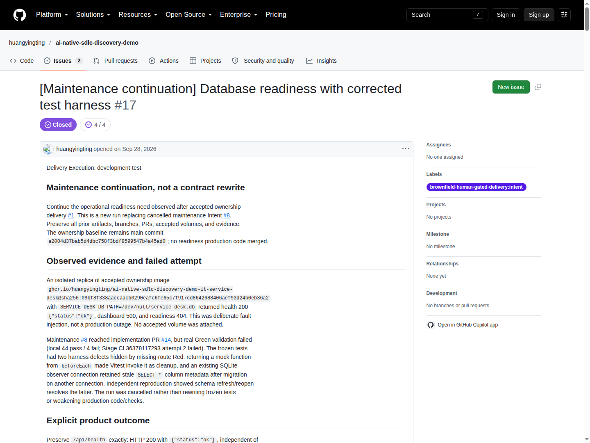
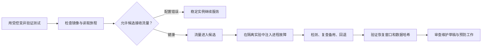
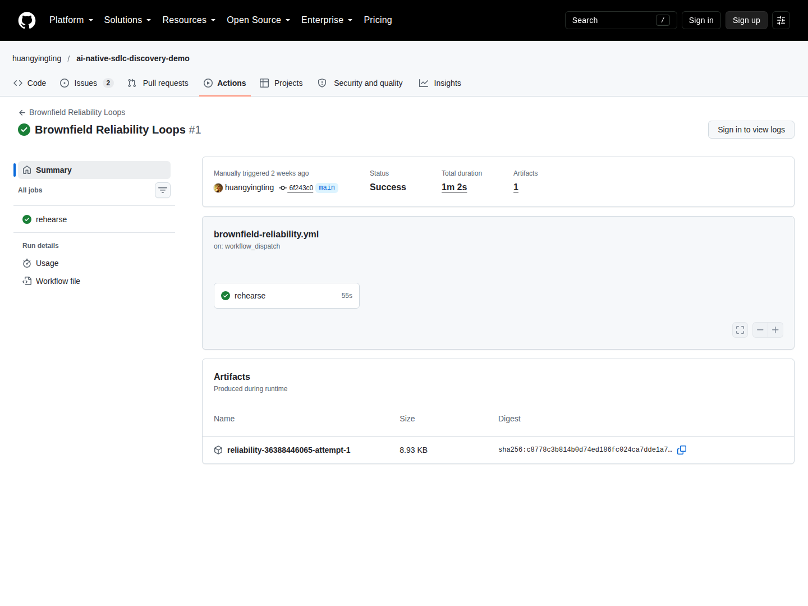

# 4. 部署、运行与学习：合并之后还要闭环

[指南目录](../README.md) · [English](../en/04-deploy-operate.md) ·
[上一章](03-build-verify.md) · [下一章：工程判断](05-engineering-judgment.md)

## 4.1 合并、发布、验收是三件不同的事

[](https://github.com/huangyingting/ai-native-sdlc-discovery-demo/actions/runs/36381916918/attempts/2)

**图 D。** 2026 年 10 月 12 日查看的真实 readiness 发布运行。
先看 `publish` 和 `verify`，再看父 Intent 中绑定 digest 的记录。
Artifacts 表里的 SHA-256 标识可下载的工作流文件，**不是 GHCR 镜像 digest**。

在这个仓库中：

1. 必需审查和检查允许受保护的合并。
2. 发布构建并推送镜像。
3. 验证拉取精确 digest，启动临时容器。
4. 审查者针对该制品操作已批准行为。
5. 满足规则的验收才关闭 Intent。

`it-service-desk-demo` Environment 代表临时容器验证，**不是永久公开部署**。
合并也不会自动升级某个旧本地实例。

最终 readiness 交付身份：

| 项目 | 值 |
|---|---|
| 合并后的应用版本 | `d361ce032b0f729f62b165c23c4f79bb56f29b92` |
| 发布／验证 | Run `36381916918`，attempt `2` |
| GHCR 镜像 digest | `sha256:1fab5706994daec051dbd183ea42a23ab0e74e2caeefeef1e48454fe17aaa5bb` |
| 验收 | [延续 Intent 中记录的真实观察](https://github.com/huangyingting/ai-native-sdlc-discovery-demo/issues/17#issuecomment-5864107648) |

[完整镜像名称和运行步骤](../../brownfield-discovery-maintenance-rehearsal.md#run-the-published-maintenance-digest-on-a-fresh-workstation)
保存在权威报告中。使用新的隔离数据卷和可用回环端口，不要把已验收的历史数据
挂到实验容器上。

## 4.2 验收用户旅程，而不是只看端点

[](../../assets/brownfield-case-study/ticket-detail.png)

**图 E。** 2026 年 9 月 27 日另一个早期归属 demo。看实际元数据和带标签控件，
不要误认为这是后续 readiness 演练的截图。

[](../../assets/brownfield-case-study/owner-filter.png)

**图 F。** 早期归属案例的组合筛选。界面说明 AND 语义；数据持久化和导航
仍然需要独立证据。

一次新的归属验收可以这样进行：

1. 打开应用前记录 digest 和 verification attempt。
2. 检查旧记录和初始未分配状态。
3. 分配、重分配、清空，比较详情与队列。
4. 刷新并使用同一实验数据卷重启，检查持久化。
5. 验证精确结果集、空结果和导航。
6. 在隔离环境安全提交非法输入，确认无数据改变。
7. 检查原有创建、状态、搜索行为。
8. 写清真正观察到的结果以及未测试内容。

截图记录可见状态；测试和只读数据库比较证明无操作写入、完整字段保留和
旧 schema 迁移。两种证据不能互相替代。

有权限的审查者在 **新演练** 中提交：

```text
/sdlc accept sha256:<64hex>
<实际执行的场景、观察、证据链接和限制。>
```

失败则使用 `/sdlc reject sha256:<64hex>` 并写真实失败。替换占位符，不能接受
没有操作过的镜像。在仍未结束的运行中，即使 digest 相同，重新验证也会使旧验收
失效；已接受的运行是终态，后续交付需要新 Intent。

历史案例中的决定是授权脚本化 development-test 行为，不是独立人员验收。

## 4.3 观察差距，再创建新工作

归属交付后，一个使用非法数据库路径的临时副本返回：

| 请求 | 观察 | 含义 |
|---|---|---|
| `/api/health` | 200，`{"status":"ok"}` | 进程仍存活 |
| `/` | 500 | 用户旅程不可用 |
| `/api/ready` | 404 | 尚无依赖就绪端点 |

这是主动故障注入，不是生产事故。此前交付验证也检查 dashboard，没有证据说明
它接受了这个坏副本。Liveness 本身按设计工作，但运行层还需要单独的 readiness。

新要求变成独立维护 Intent：

- 保留现有 liveness。
- 每次 readiness 请求都访问数据库。
- 健康：200，精确返回 `{"status":"ready"}`。
- 不可用：503，精确返回 `{"status":"unavailable"}`。
- 两者都带 `Cache-Control: no-store`。
- 日志只写固定通用消息，不输出路径、异常细节或堆栈。
- 修复后验证恢复，且保留数据。

[](https://github.com/huangyingting/ai-native-sdlc-discovery-demo/issues/17)

**图 G。**
[huangyingting/ai-native-sdlc-discovery-demo#17](https://github.com/huangyingting/ai-native-sdlc-discovery-demo/issues/17)
保留被取消的尝试，并解释新契约，没有改写已接受的归属交付。

延续任务真实验收覆盖：健康 readiness、非法路径 readiness、未改变的 liveness、
脱敏日志、50 次重复 readiness 请求、完整数据保留和同数据卷重启。
配置修复是重新创建临时实例，不是修改运行中进程的环境变量。

## 4.4 三个小而完整的可靠性闭环



1. **可信验证：** 原始／恢复后的 13 项控制测试和六个指定变异，证明有限范围内
   的 readiness 测试能力。
2. **安全本地准入与恢复：** 拒绝坏配置，接收健康候选；暂停候选，再检查稳定
   实例后回退。
3. **运行反馈：** 记录事件与恢复，生成尚未批准的维护草稿，审查和实现预防
   范围，重复检查后再关闭任务。

[](https://github.com/huangyingting/ai-native-sdlc-discovery-demo/actions/runs/36388446065)

**图 H。** 真实 [托管运行 36388446065](https://github.com/huangyingting/ai-native-sdlc-discovery-demo/actions/runs/36388446065)。
摘要页面用于导航，证明细节见 [测量报告](../../brownfield-reliability-rehearsal.md)。
Artifact 保留期有限，截图中出现不代表以后仍能下载。

两次本地重复都拒绝坏配置、恰好回退一次，并通过单独的五样本恢复窗口。
观察到的检测时间为 4,208／4,207 毫秒，恢复确认时间为 733／882 毫秒。
托管重复的真实数据在报告里单独记录。

这些是短时间、主动注入故障的 **同镜像、只读网关实验**，不证明生产 MTTR、
SLO、任意写流量安全、跨版本回滚或备份恢复。数据哈希比较只覆盖本场景中受控的
完整 schema 和数据行。

## 4.5 恢复不等于预防工作完成

流量回到稳定实例，回答“读取旅程是否重新可用”；它没有回答“是否防止了复发”。

普通维护任务
[huangyingting/ai-native-sdlc-discovery-demo#25](https://github.com/huangyingting/ai-native-sdlc-discovery-demo/issues/25)
关联审查范围和
[huangyingting/ai-native-sdlc-discovery-demo#26](https://github.com/huangyingting/ai-native-sdlc-discovery-demo/pull/26)。
真实合并后托管演练完成才关闭任务，不是 AI 生成草稿就结束。

团队实践中，应明确运维负责人，把观察和假设分开，记录预防方案、验收检查及
变更后结果。根因不知道就写未知，“AI 已诊断”不是根因证据。

### 退出检查与生产差距

- [ ] digest、源 SHA、run、attempt 指向同一次交付。
- [ ] smoke 之外还有用户旅程观察。
- [ ] 故障演练使用隔离资源并验证清理。
- [ ] 恢复与预防闭环分别有证据。
- [ ] 维护任务链接原观察，不改写旧批准。

进入生产前，还应按系统风险增加：独立审批、签名来源与准入、授权和隐私审查、
容量／负载测试、跨版本数据库兼容、经过验证的备份恢复、值班责任、SLO 和
业务效果测量。这些是 **仍需完成的工作**，不能从截图中推导为已经具备。

[下一章：诚实评估变更、诊断和 Agent 策略](05-engineering-judgment.md)。
