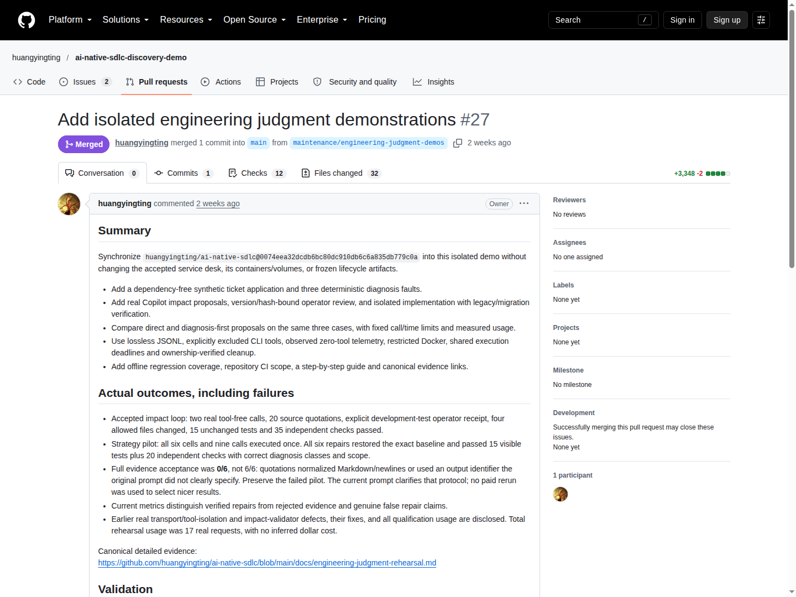
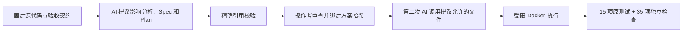

# 5. 变更、诊断与 Agent 评估

[指南目录](../README.md) · [English](../en/05-engineering-judgment.md) ·
[上一章](04-deploy-operate.md) · [下一章：实操与落地](06-workshop.md)

## 5.1 为什么单独建工程实验室？

已接受的服务台和历史契约必须保持完整。因此，独立的
[engineering fixture](../../../demos/engineering-lab/) 提供一个没有第三方依赖的
合成 Node.js 应用，拥有自己的 manifest、锁文件和测试；
[复用工具](../../../tools/engineering-demo/README.md) 在源码目录之外执行实验。

这不是另一次服务台部署。Proxy 功能只存在于通过验证的实验候选中；提交到仓库的
基线刻意保持无 proxy，下一次才可以从相同输入开始。

[](https://github.com/huangyingting/ai-native-sdlc-discovery-demo/pull/27)

**图 I。**
[huangyingting/ai-native-sdlc-discovery-demo#27](https://github.com/huangyingting/ai-native-sdlc-discovery-demo/pull/27)
发布工具和真实结果，包括失败；它不是 proxy 实现的交付 PR。
测量、哈希和前置资格验证开销见 [完整实验报告](../../engineering-judgment-rehearsal.md)。

## 5.2 变更影响闭环：小字段会改变多个契约

需求是增加临时代理负责人，但不能替换承担责任的原负责人：

```text
effectiveOwner = proxyOwner ?? owner ?? null
```

一个不完整的捷径是只在返回的 JSON 中加字段。完整变更还必须处理存储、
筛选和旧消费者。

| 表面 | 必须思考的问题 | 独立验证 |
|---|---|---|
| 领域逻辑 | proxy 优先；owner 仍承担责任；AND 筛选 | proxy／回退／null 和组合筛选 |
| 存储 | 可空 `proxy_owner`；增量且幂等的迁移 | 真实旧 schema、字段保留、重开持久化 |
| 修改 API | `assignProxy(id, proxyOwner)` 校验编号和值 | 非法输入无新增／修改；null 清空 |
| 序列化 | 保留原字段，增加 `proxyOwner` 和 `effectiveOwner` | 精确字段行为，包括 null |
| 文档／消费者 | 解释语义与兼容性 | 更新契约；原有测试和消费者行为不变 |



成功演练产生 **20 条精确引用**、明确的哈希绑定操作批准，以及仅四个允许文件的
变更。15 项原测试和 35 项独立检查全部通过。凭据明确写了
`independentHumanReview:false`，不能宣传为独立人员批准。

此前验证器错误地限制“每个可编辑文件只能引用一次”。模型其实正确地引用了
同一文件的多项事实和无需修改的消费者。修正后区分 **影响范围** 和 **编辑权限**：
分析可以涉及消费者，但不因此获得修改消费者的权限。被拒绝的尝试保留原样。

**可迁移经验：** 影响分析不仅包括准备修改的文件，还要包括必须继续成立的
未修改契约。

## 5.3 诊断：先判断哪一层错了

三个固定故障分别注入相同基线的新副本：

| 案例 | 注入故障 | 正确处理 | 错误捷径 |
|---|---|---|---|
| 产品 | owner／status 交集变成 OR | 修产品谓词 | 放松预期集合 |
| 测试工具 | 预期 owner 与未变契约冲突 | 恢复精确原断言 | 修改正确产品来迎合漂移测试 |
| 环境 | 数据库路径位于 `/dev/null` 下面 | 修运行配置 | 重写存储或不断重试 |

Agent 收到真实失败输出和相关合成文件，不收到预期分类或独立 oracle 实现。
它要返回分类、精确证据和最小文件变更。宿主适配器限制路径；生成代码只能在
非 root、只读、无网络、资源受限的 Docker 中执行，临时写空间可丢弃。

CLI 通道经过实际资格验证：

- JSONL 保留精确内容；此前普通终端渲染会折行，从而破坏 JSON。
- 测试版本中空的 `--available-tools=` **没有**删除工具，需要显式排除，并观察
  零工具遥测。
- 缺失／意外遥测或出现工具请求会导致拒绝。
- Docker 准备与执行共用截止时间；所属资源的清理有单独上限。

这些约束用于授权实验，不是正式沙箱安全认证，也不能保证未来所有 CLI 版本
都没有副作用。工具或事件协议变化后，真实使用前需要重新资格验证。

## 5.4 比较策略，不比较故事

实验比较：

- **Direct：** 一次响应包含诊断和修复。
- **Diagnose-first：** 第一次诊断，第二次新调用根据诊断交接提出修复。

这不是两个独立人类审查者，也不一定是两个模型。两者拥有相同最高额度：
每个单元最多两次调用、300 秒，每次调用最多 120 秒。Direct 实际一次，
diagnose-first 两次，因此六个单元共九次计划调用。顺序交替，源代码／故障／
oracle 相同，没有自动重试或人工补代码。相同上限不等于相同 tokens 或实际成本。

| 实验指标 | Direct | Diagnose-first |
|---|---:|---:|
| 案例 | 3 | 3 |
| 独立验证的修复 | 3/3 | 3/3 |
| 完整证据接受 | 0/3 | 0/3 |
| 实际调用 | 3 | 6 |
| 输入 tokens | 24,591 | 50,262 |
| 输出 tokens | 1,136 | 2,449 |
| 单元墙钟时间合计 | 91,865 毫秒 | 155,140 毫秒 |
| 报告的 premium-request 单位 | 3 | 6 |
| 账单美元成本 | 未知 | 未知 |

六个候选全部恢复到精确基线，每个都通过 **15 项可见测试和 20 项独立检查**，
分类与修改范围也正确。但完整证据全部被拒绝：

- 部分引用规范化了 Markdown 标点或换行，不再是精确子串。
- 部分使用 “Actual failing test output”，而不是验证器保留路径 `test-output`；
  原提示没有明确说明这个标识。

结果为 **`completed-with-failures`，退出码 2**。当前提示已经澄清协议，
但 **修正后没有重跑付费实验**。不能虚构更高接受率，也不能把未充分说明的协议
完全归咎于模型能力。

当前指标分开记录：

| 指标 | 含义 |
|---|---|
| `repairsVerified` | 行为测试和独立 oracle 通过 |
| `evidenceAccepted` | 诊断证据满足契约 |
| `unacceptedCompletionClaims` | 声称完成，但未通过完整门禁 |
| `falseCompletionClaims` | 声称修复，实际行为验证却失败 |

原报告把 false completion 用得过宽；工具已经修正，历史报告也明确解释，
没有悄悄修改旧证据。**修复正确、引用不合格，不等于虚报修复。**

每种策略只有三个小案例各一次，不能形成有统计显著性的胜者。本次 diagnose-first
用量更多，却没有改变修复结果，这是有价值的局部证据，不是普遍规律。

## 5.5 用 Trace 理解执行，不用 Trace 替代质量

[](https://huangyingting.github.io/ai-native-sdlc/viewer/?run=36092002982)

**图 J。** 独立的已有
[direct-execution trace](https://huangyingting.github.io/ai-native-sdlc/viewer/?run=36092002982)，
2026 年 10 月 12 日截图。它不是工程实验的九次调用之一。界面基于价格模型显示的
**估算成本** 不是账单支出，不能替代工程实验中未知的美元成本。

建议依次阅读：

1. 核对运行身份与实际观察模型，不只看请求模型。
2. 读层级：orchestrator、模型、工具以及可能存在的 subagent。
3. 判断并行要看独立分支时间是否重叠，不只数 Agent 个数。
4. 结合上下文看失败：一个失败工具可能在整体成功前已被恢复。
5. 核对实际用量与缓存处理。缓存输入属于输入子集，不能再加一次。
6. 问清这张图 **没有**证明哪些产品行为。

[编排模式指南](../../copilot-cli-agent-orchestration-patterns.md) 包含直接执行、
并行委派、批评－修订和顺序流水线。当前截图只演示直接执行。Critic 可以挑战
假设，但多一个 AI 声音不自动等于独立证据。

### 可复用的评估卡

下次实验执行前，预先声明：

- 不可变源代码、任务、允许改动和隐藏／独立检查。
- 策略、模型配置；执行后记录真实模型。
- 调用／时间上限、重试规则和人工介入。
- 功能、回归、证据质量和范围遵守分别如何判断。
- 实际用量、缺失遥测、前置开销和所有失败。
- 样本量，以及不能得出的结论。

保留所有尝试。不能把未知成本当作零、无依据地把 CLI 单位换成美元，也不能
把多次尝试中选出的成功写成“第一次就成功”。

[下一章：如何讲解、复现并让团队采用](06-workshop.md)。
