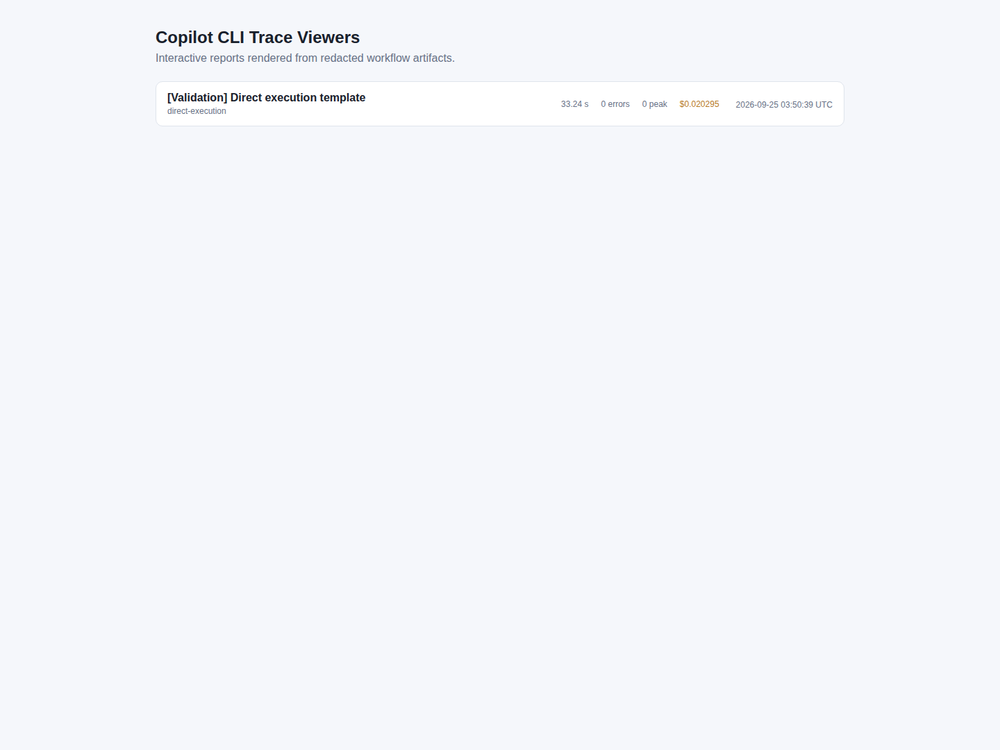

# 6. 演示、实操与团队落地

[指南目录](../README.md) · [English](../en/06-workshop.md) ·
[上一章](05-engineering-judgment.md) · [证据索引](../evidence.md)

## 6.1 打开终端之前，先选模式

| 模式 | 做什么 | 可以声称什么 |
|---|---|---|
| 只读讲解 | 打开指南、截图和已有证据页面 | “这次历史运行观察到……” |
| 本地隔离验证 | 在新资源中启动已审查镜像或运行固定离线检查 | 仅限这次新运行实际检查的行为 |
| 新 AI 交付／实验 | 新仓库／输出目录、配置身份、真实模型调用、完整验证 | 新运行记录的结果，包括失败和人工介入 |

阅读不需要额外部署文档网站。已有
[公共 Trace Viewer](https://huangyingting.github.io/ai-native-sdlc/) 可以交互检查执行。
旧应用的 localhost 地址不是公开服务，编写指南时不可用。应使用带日期截图，
或明确启动新隔离实例，不要假装截图就是正在运行的应用。

## 6.2 一套 60 分钟逐页讲解路线

[](https://huangyingting.github.io/ai-native-sdlc/)

**图 J1。** 2026 年 10 月 12 日查看的现有报告集合。截图时只有一个直接执行报告，
不代表所有支持的编排模式都有完成证据。打开报告即可交互查看详情。

演示前把以下页面放入不同标签页。这条路线不需要发评论、批准、重新运行
工作流或修改任何系统。

| 时间 | 展示页面 | 讲什么 | 问听众什么 |
|---|---|---|---|
| 0–5 分钟 | [历史队列](../../assets/brownfield-case-study/ticket-queue.png) 与 [第 1 章](01-operating-model.md) | 负责人可见是结果，过程是背后的证据链 | 截图不能证明什么？ |
| 5–15 分钟 | [huangyingting/ai-native-sdlc-discovery-demo#1](https://github.com/huangyingting/ai-native-sdlc-discovery-demo/issues/1)，再看 [批准被阻止](https://github.com/huangyingting/ai-native-sdlc-discovery-demo/issues/1#issuecomment-5862230300) | 原始问题、未决选择；为何不能由 AI 直接决定产品规则 | 如果负责人必填，哪些行为会变？ |
| 15–22 分钟 | [冻结的审查状态](https://github.com/huangyingting/ai-native-sdlc-discovery-demo/blob/073c6fb0831e38d5513e22ac193a7bdaac2918cf/docs/delivery-runs/brownfield-human-gated-delivery/1/document-review.json) 与 [第 2 章](02-intent-spec-plan.md) | 决策 → Spec 版本 → 关联 Plan → 冻结 | Spec 修改后，什么批准会过期？ |
| 22–32 分钟 | [Tests PR](https://github.com/huangyingting/ai-native-sdlc-discovery-demo/pull/6) 与 [Red attempt 2](https://github.com/huangyingting/ai-native-sdlc-discovery-demo/actions/runs/36372294023/attempts/2) | 审查真实断言；解释为何预期 Red 的校验任务为绿 | 时间戳不变为什么不能证明无写入？ |
| 32–39 分钟 | [Implementation PR](https://github.com/huangyingting/ai-native-sdlc-discovery-demo/pull/7)、[发布验证](https://github.com/huangyingting/ai-native-sdlc-discovery-demo/actions/runs/36381916918/attempts/2)、[第 4 章](04-deploy-operate.md) | 明确从归属增量切换到后续 readiness 增量，各追溯各自 digest | 下载包摘要是不是镜像摘要？ |
| 39–48 分钟 | [失败维护](https://github.com/huangyingting/ai-native-sdlc-discovery-demo/pull/14)、[延续任务](https://github.com/huangyingting/ai-native-sdlc-discovery-demo/issues/17)、[可靠性演练](https://github.com/huangyingting/ai-native-sdlc-discovery-demo/actions/runs/36388446065) | 保留失败契约；区分恢复与预防闭环 | 为什么不能偷偷“修好”冻结测试？ |
| 48–56 分钟 | [工程报告](../../engineering-judgment-rehearsal.md) 与 [第 5 章](05-engineering-judgment.md) | 六次修复全部正确，完整证据全部未通过 | 是产品失败、证据失败，还是二者皆有？ |
| 56–60 分钟 | [真实直接执行 trace](https://huangyingting.github.io/ai-native-sdlc/viewer/?run=36092002982) 和下文落地检查表 | Trace 解释工作，独立检查证明结果 | 团队最小可落地闭环是什么？ |

20 分钟介绍可只选队列、阻塞批准、Tests PR、发布与验收区别、6/6 对比 0/6。
半天工作坊可以加入下文练习。不要承诺固定演示时间内完成整条云端交付：
模型队列、审查、权限和构建都是外部依赖。

### 页面阅读顺序

- **Issue：** 原始问题 → 最新 hub → 完整版本 → 决策 → 批准。
- **PR：** base／head → 文件 → 审查 → 检查 → 合并。
- **Actions：** 精确源代码 → run／attempt → 必需任务 → 日志／摘要 →
  审查过的 artifact；需要登录的日志使用正常授权账号访问。
- **应用：** 固定数据 → 用户动作 → 结果 → 持久化和负面检查，不只是首页能打开。
- **Trace：** 身份 → 层级 → 时间重叠 → 错误 → 实测用量 → 尚未验证内容。

## 6.3 路线 A：不发生真实模型调用

在源仓库根目录，使用 Node.js 24：

```sh
npm test
npm --prefix demos/engineering-lab test
node tools/brownfield-demo/cli.mjs --help
node tools/brownfield-demo/cli.mjs scenario list
node tools/engineering-demo/cli.mjs --help
```

这些检查／帮助命令不会调用 Copilot。缺依赖时按所属项目说明恢复，不要把 demo
依赖加到根目录。

历史基线为 456 项仓库测试和 15 项 fixture 测试。你的 checkout 可能演进，
应报告实际数量，不照抄旧数字。`scenario list` 列出的是计划，状态为
`planned-not-evidence`；存在场景定义不代表执行完成。

不调用模型也能进行的练习：

1. 比较真实 Intent 和最新 Spec，找到一条决策到验收条件的映射，以及一个非目标。
2. 阅读 Tests 审查，设计一个能骗过薄弱断言的错误实现。
3. 对比失败维护和延续任务，指出改变了什么、哪些历史记录保留不动。
4. 解释工程实验为什么既不是“全部失败”，也不是“全部验收成功”。

## 6.4 路线 B：新的完整交付

完整设置遵循已有 [有序操作手册](../../brownfield-human-gated-delivery-walkthrough.md#1-prepare-the-repository)，
顺序不能省略：

1. 选择经审查的 **完整 40 位源提交 SHA**，应用仍未实现 ownership，且包含当前
   编排。不要使用已经完成的 demo 基线。
2. 选择新的外部目标目录、新的已约定远程仓库和明确审查模式。目标不能已存在，
   但父目录必须存在。
3. 导出固定场景：

   ```sh
   node tools/brownfield-demo/cli.mjs prepare \
     --source /absolute/path/to/ai-native-sdlc \
     --source-ref FULL_40_HEX_COMMIT \
     --dest /absolute/path/to/new-isolated-demo \
     --reviewer YOUR_GITHUB_LOGIN \
     --scenario ownership-standard
   ```

4. 检查导出内容和 provenance 是否可以公开。Prepare 不初始化 Git、不创建
   remote、不推送。
5. 明确初始化并发布已审查导出。确认远程 `main`、工作流注册、审查者权限。
6. **从新 checkout** 预览设置，处理权限、Copilot entitlement、镜像访问和拟议
   分支保护；只应用已同意的改动，通过安全凭据流程配置。
7. 做只读 preflight，交给真实有资格的审查者。
8. 提交新 Intent，按第 2–4 章完成真实验收。

只有明确选择单人演练时才使用 `--single-owner`，并按文档在 prepare／setup／
preflight 中保持一致。单人不等于独立审查。不要误对刻意不保护的源仓库 main
应用完整 setup；不要把 token 写入命令／聊天；不要 force-push 覆盖完成态。

**何时必须停下：** 访问／计费未确认、工作流未注册、基线不匹配、审查者不在、
必需检查失败、digest 未验证、清理失败。不能为了赶完演示而绕过门禁。

## 6.5 路线 C：更小的专题实验

### 变更影响与策略评估

前提：Node.js 24、Docker、Git、已认证 Copilot CLI，以及明确接受的使用费用。
检查 [已资格验证的 CLI 版本和协议](../../engineering-judgment-demos.md#2-prerequisites)；
安装了更高版本不代表已经验证兼容。

历史 fixture 源提交为 `540cacd2a10be5ed326479fd959d21eec5d4997c`。
源代码版本和执行工具版本是两个身份。使用新输出目录，同一对比实验的各单元
使用相同不可变运行镜像。

遵循精确的 [impact 命令步骤](../../engineering-judgment-demos.md#3-change-impact-and-consistency-loop)：

1. `impact-propose`：真实模型调用；阅读完整候选。
2. `impact-approve`：对精确 `proposalHash` 生成本地操作凭据；不能只因生成退出码
   为零就批准。
3. `impact-implement`：第二次真实调用；受限测试／oracle 决定结果。
4. 可选 `benchmark`：六个单元，共九次计划中的真实调用。

它们是 CLI 实验，不是独立 Web UI，也不自动做 GitHub 交付。完整语法见上文 help。
保留输出、批准、用量、候选／测试／oracle 结果、源／工具身份和所有失败。
提议阶段退出码 0 可能只是 **等待操作者审查**；2 表示有候选失败但实验完成；
1 表示错误。

### 不再调用模型的可靠性实验

有完成态 readiness 源代码与镜像访问权限后，按
[测试资格验证](../../brownfield-reliability-loops.md#3-start-here-qualify-the-tests)，
再按 [运行演练](../../brownfield-reliability-loops.md#4-run-real-image-verification-admission-recovery-and-monitoring)。
它们运行真实测试／Docker／HTTP／SQLite，而不是 Copilot 调用；镜像／依赖下载
和计算仍可能有成本。

不能把没有 readiness 的源应用当作已有 readiness 来验证；不能复用已验收数据卷，
对共享工作负载注入故障，或把生成维护草稿当作已审查的预防工作。

## 6.6 恢复与证据交接

| 情况 | 支持的处理 |
|---|---|
| 文档生成／交接失败 | 找原因，再使用文档规定的 `/sdlc retry` 或同一 Intent 的 Documents dispatch |
| 工程 CI／Advance／Publish 失败 | 修原因，再重跑真正失败的 Action；文档 retry 不修这些任务 |
| 需要暂停活动运行 | 使用 `/sdlc pause`，之后 `/sdlc resume`，不直接改状态 |
| 冻结范围有误 | 明确新 Intent／延续，保留取消证据 |
| Artifact 过期 | 使用持久报告／提交／Issue 引用；原始证据不可用就写不可用，不伪造日志 |
| 本地应用不可用 | 展示带日期截图或明确启动隔离实例，不声称当前健康 |

每次运行至少保留：

```text
仓库 + Intent URL + 执行模式
源／工具提交 + 场景／输入哈希
决策 + Spec／Plan 版本和哈希 + 批准身份
Tests／实现 head + Red／Green run 和 attempt
合并 SHA + 镜像 digest + 验证 run 和 attempt
真实验收观察 + 限制
失败／重试／人工介入 + 实际用量
资源归属 + 清理结果 + 运维后续任务
```

私有提示、原始 CLI 事件、数据库、payload 和日志放在 Git 之外。脱敏不保证任意
自由文本没有敏感信息；公开经审查的摘要与引用。

## 6.7 先落地一个可信闭环，再扩大规模

| 步骤 | 团队约定 | 可观察结果 |
|---|---|---|
| 1. 选择小而真实的变更 | 负责人、范围、基线、非目标 | 经审查 Intent，不是“拥抱 AI”的口号 |
| 2. 显式处理歧义 | 谁决策、什么阻塞推进 | 决策表和可测试标准 |
| 3. 分离提议和授权 | 工具／文件范围、审查／执行角色 | AI 不能静默批准或扩展范围 |
| 4. 独立验证 | 旧行为、负面场景和证据身份 | 可重复检查，不是模型断言 |
| 5. 验收精确制品 | 部署／恢复负责人和验收步骤 | 绑定 digest 的观察 |
| 6. 观察和测量 | 运行反馈与质量／成本定义 | 经审查后续工作和可比较结果 |

可用指标包括首轮验收通过率、逃逸回归、被发现的无依据假设、审查返工、
交付耗时、人工介入和实际模型用量。先建立真实基线与测量规则；
仓库没有提供已测量的客户 ROI。

按仓库已有规则声明 **Demo Ready** 之前，需要完成三次真正由人参与决策的独立
隔离场景：正常交付、显式 Spec 修改／Plan 失效、可恢复失败。
历史脚本化 development-test 运行不满足这个认证。

最重要的结论不是“AI 取消所有门禁”，而是：
**让有用提议更容易产生，让无证据推进更难发生，让每个结果都可以检查。**

[返回目录](../README.md) · [打开证据与截图索引](../evidence.md)。
