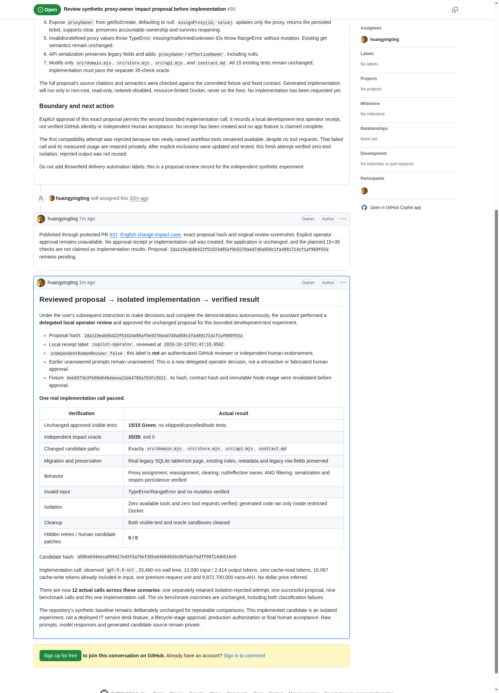

# Change impact: from reviewed proposal to compatible implementation

[中文](change-impact.md) · [Case index](README.en.md) · [Diagnosis and strategy](engineering-judgment.en.md)

**Engineering appendix, not a Coding Agent product PR.** Copilot CLI generated
the proposal and candidate text; the trusted harness executed verification.
The assistant published the Issue summaries through the authorized user account.
See [roles and comment provenance](../copilot-roles.en.md).

<a id="current-gate"></a>
## Result and review boundary

A real Copilot call generated a complete impact proposal, its citations and
semantics were reviewed, and the isolated baseline passed **15/15**.
Following the user's subsequent instruction to make decisions and complete
the demonstrations autonomously, the assistant performed a **delegated local
operator review** and approved this unchanged proposal for one bounded call.
The implementation passed **15/15 unchanged tests and 35/35 independent checks**.

[Proposal review](https://github.com/huangyingting/ai-native-sdlc-demo/issues/30)
and the [completed result](https://github.com/huangyingting/ai-native-sdlc-demo/issues/30#issuecomment-6136318336)
are the durable English records. The receipt label `copilot-operator` is not an
authenticated GitHub reviewer; `independentHumanReview` is false. Earlier
unanswered prompts were not retroactively treated as approval.

The baseline [engineering application](../../demos/engineering-lab/README.en.md)
remains deliberately unchanged for repeatable comparisons. The proxy
implementation exists in an isolated candidate, not a deployed service-desk
feature or an accepted production delivery.


The original pending-review screenshot remains unchanged. The subsequent
delegated review and actual Green result are recorded separately:



See [screenshot provenance](assets/engineering/manifest.json) and the
[sanitized implementation summary](assets/engineering/impact-summary.json).

## What Copilot actually produced

The fixed input began with this exact request excerpt:

> Add temporary proxy assignment to the ticket application, preserving all existing behavior and approved tests.

The CLI received committed synthetic source and the fixed contract, not the
independent acceptance oracle. A selected proposal decision was:

> Create new tables with nullable proxy_owner TEXT and, after opening, inspect the existing tickets schema and issue ALTER TABLE tickets ADD COLUMN proxy_owner TEXT only when the column is absent.

The implementation's actual rationale was:

> Implements temporary proxy ownership while preserving accountable ownership and legacy behavior. The store adds an idempotent additive proxy_owner migration, exposes proxyOwner on persisted tickets, validates and persists proxy assignment/clearing, and the API serializes both proxyOwner and effectiveOwner. Documentation covers ownership semantics, filtering, errors, persistence, and migration compatibility.

A selected difference in `src/domain.mjs` shows the model's proposal, rather
than only an operator's description:

```diff
-  return ticket.owner ?? null;
+  return ticket.proxyOwner ?? ticket.owner ?? null;
```

The trusted adapter applied allowlisted candidate text; Docker and the independent
oracle then established 15/15 and 35/35. The model did not run those checks itself.
[Reviewed exact excerpts](assets/engineering/copilot-excerpts.json) bind the
proposal and implementation selections to the response hashes in the measured
summary. Only selected text/differences are published, not complete raw payloads.

## Proposed business behavior

The accountable owner must not be overwritten by a temporary proxy.
The fixture's supported owners are `avery` and `jordan`.

```text
effectiveOwner(ticket) = ticket.proxyOwner ?? ticket.owner ?? null
```

Assign, reassign or clear a nullable proxy while preserving ticket identity,
title, status and accountable owner. Filtering uses the effective owner and
intersects the status condition with AND, including unassigned tickets.
Existing and newly created tickets start with `proxyOwner: null`.

## Impact surfaces and constraints

| Surface in the engineering fixture | Proposed change | Preservation requirement |
|---|---|---|
| [Domain](../../demos/engineering-lab/src/domain.mjs) | Effective owner, proxy validation and combined filtering | Accountable owner unchanged; null semantics and AND preserved |
| [Store](../../demos/engineering-lab/src/store.mjs) | Nullable SQLite `proxy_owner`; `assignProxy` | Additive idempotent migration, no table rebuild or legacy-data loss, persisted reopen |
| [API](../../demos/engineering-lab/src/api.mjs) | Serialize `proxyOwner` and `effectiveOwner`, including null | Original serialized fields preserved |
| [Contract](../../demos/engineering-lab/contract.md) | Document behavior, validation, clearing and migration | No unsupported identity or authorization feature |

Only those four files may change. Invalid or undefined proxy values must throw
`TypeError`; missing, nonpositive, noninteger or nonnumeric IDs must throw
`RangeError`, without inserting or changing a ticket. Both supported owners
and null are valid assignments. All fifteen approved visible tests remain
unchanged. Implementation must also pass **35 independent impact checks**.
The candidate satisfied these requirements; all approved test blobs remained
unchanged, and only the four permitted files differed from baseline.

## Exact proposal binding

| Binding | Value |
|---|---|
| Proposal hash | `2da119edb9b422f51024d85af9e9278aed748a958c1fa4891714cf1af869f02a` |
| Fixture source | `0eb9973b3fb09d648ebeea21b64786a763fc3021` |
| Fixture hash | `4d25f387db0329a1add68680ebd2f52974ae58e5996ce0adb3e61b12c40f351d` |
| Contract hash | `1581ec33f802fe9c0d638dc0ebb19d1ac8f78c65c1e36d3799dfbb53fa554eba` |
| Sandbox image | `node@sha256:0e0ff40c39bc087845bfb27465a0df4ea419520094bc35842ff83dd8cbe6f9b6` |

Approval must bind the unchanged proposal, fixture, contract and immutable
image. A revised proposal needs a new hash and review. A local operator receipt
is a development-test gate, not authenticated GitHub Human acceptance or an
approval of a separate delivery stage.

<a id="real-proposal-cost-and-isolation"></a>
## Real call cost and isolation

The qualified proposal used the observed default `gpt-5.6-sol` model:
one call, **50,733 ms** wall time, **7,209 input / 3,445 output tokens**,
zero cache-read tokens and 7,206 cache-write tokens already included in input.
Recorded usage was one premium-request unit and **10,494,200,000 nano-AIU**;
no dollar price was inferred. Zero tools and zero tool requests were verified,
and the 15-test control sandbox was cleaned.

The single implementation call used the same observed model: **33,480 ms**,
**10,090 input / 2,414 output tokens**, zero cache-read tokens,
10,087 cache-write tokens included in input, one premium-request unit and
**9,872,700,000 nano-AIU**. Zero tools were verified again; both the visible-test
and oracle sandboxes were cleaned. No implementation retry or human candidate
patch occurred.

The earlier isolation-rejected call remains separate: 45,871 ms,
8,294 input / 3,182 output tokens, one premium-request unit and
10,510,700,000 nano-AIU. Two available tool aliases caused rejection despite
zero requests. Its output was not reused or executed. This is a disclosed
compatibility failure, not a hidden successful proposal retry.

<a id="next-authorized-step"></a>
## Verified implementation outcome

```text
Review exact proposal → delegated local approval → verify all bindings
    → one bounded implementation call → unchanged 15 tests + 35 impact checks
    → report actual outcome, including failures → clean sandbox
```

| Verified surface | Independent check |
|---|---|
| Ownership | Accountable owner unchanged; assign, reassign and clear proxies; effective-owner/null matrix |
| Migration | Nullable TEXT column added; legacy table root page, index, metadata and original row fields retained |
| Persistence | Proxy assignment survives close/reopen; repeated initialization is harmless |
| Filtering and API | Owner/status AND matrix; original fields and explicit proxy/effective-owner nulls serialized |
| Invalid input | Required TypeError/RangeError; no insertion or mutation |
| Scope | Exactly four permitted files changed; fifteen approved tests unchanged; contract updated |

Candidate hash:
`a88beb04eeca099d17ed3f4a79ef35ba646845d3c6bfadcfadff88714db518e0`.
Visible verification was 15/15 with no skipped, cancelled or todo tests;
the independent oracle was 35/35, exit 0. Both cleaned successfully.

Across all current scenarios, twelve actual calls are recorded: one retained
isolation rejection, one proposal, nine benchmark calls and one implementation.
The benchmark's two classification failures remain unchanged.

Generated code ran only inside restricted Docker, never on the host; private
prompts, full raw responses and complete candidate source are not published.
Selected reviewed excerpts above explain the actual contribution. This completes the
bounded change-impact experiment, not independent human acceptance or
production authorization. Use the [reusable impact workflow](https://github.com/huangyingting/ai-native-sdlc/blob/main/docs/guides/engineering-judgment-demos.en.md)
for operator commands.
