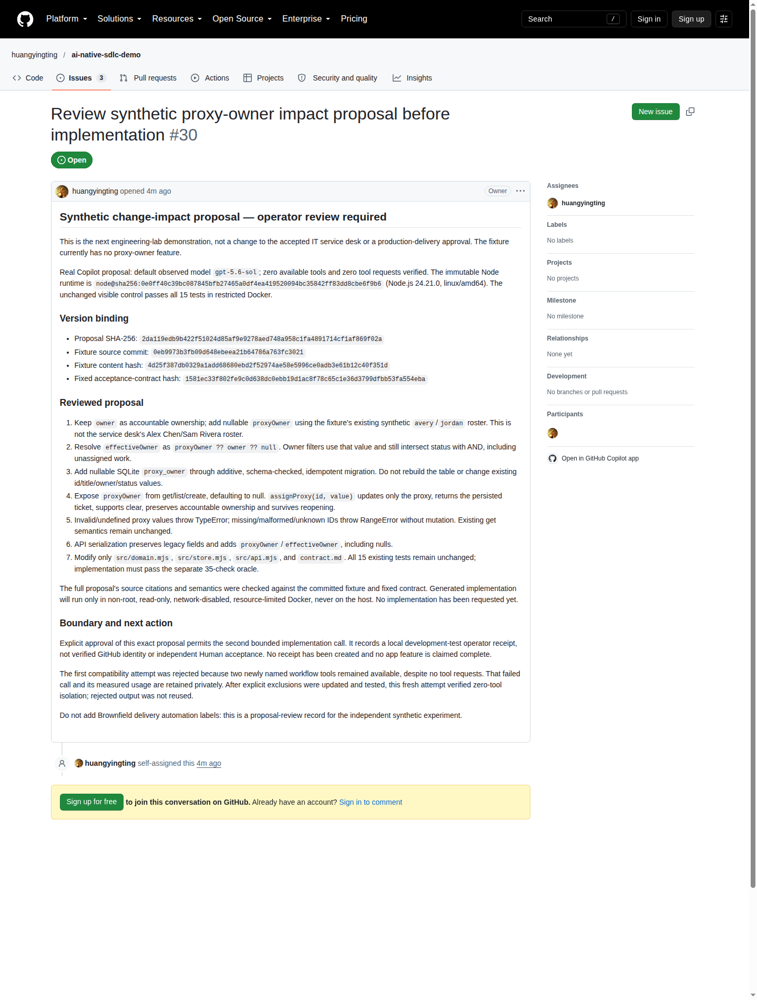

# 变更影响分析：从架构方案审查到兼容性代码落地

[English](change-impact.en.md) · [案例索引](README.md) · [故障诊断与策略评估](engineering-judgment.md)

**工程实践声明**：本专题属于受控工程实验，而非由 Coding Agent 交付的生产功能 PR。在严格受限的沙箱中，由 Copilot CLI 生成分析方案与候选代码文本，再由高可信的独立测试程序在受限 Docker 容器中执行严密验证。（详见[演示目标与 Copilot 角色规范](../copilot-roles.md)）。

<a id="当前关卡"></a>
## 核心机制深度拆解

为了透彻理解本受控工程实验的体系设计，下文系统拆解该实验的**核心痛点、双阶段受控调用模型、改动边界与质量保证机制**。

### 1. 核心痛点与工程挑战

在复杂的遗留（Brownfield）系统中，看似简单的改动（如“给工单新加一个临时代理人字段”）极易引发蝴蝶效应：

- **隐式破坏既有不变量 (Broken Invariants)**：引入 `proxyOwner` 时，极易误将原责任人 `owner` 彻底覆盖，导致责任主体丢失；或者破坏原有的多维筛选组合逻辑（如将原本严格的交集 AND 误改成 OR）。
- **向后兼容性与数据丢失风险**：表结构迁移若采用全量重构或非幂等建表，极易造成历史数据库的数据截断或丢失；旧版本调用方在解析缺少新字段的序列化结果时可能抛出崩溃。
- **大模型“自由发挥”的代码扩散**：若未设置严密的改动白名单，大语言模型在生成代码时极易“过度设计”或“自作主张”，随意改动无关模块、重写测试用例甚至引入未经审批的鉴权逻辑。

### 2. 双阶段受控调用模型与架构设计

实验设计了严格的两阶段提示与执行架构，实现人机协同的严格分工：

```text
阶段一：方案生成与引用审查 (impact-propose)
  输入：Prompt 需求 + 模拟工程源码 + 行为契约 (无独立测试判定器)
  CLI：单次调用生成变更影响分析方案 (涵盖领域、存储、API、契约 4 大维度)
  人类架构师：审查引用准确性与语义严谨性，生成本地审批凭据 proposalHash

阶段二：受限代码生成与沙箱验证 (impact-implement)
  输入：绑定已获批的方案 Hash + 样本 Hash + 契约 Hash + 不可变 Docker 镜像
  CLI：单次调用生成补丁代码文本 (受限只读，禁止工具调用)
  路径白名单适配器：仅放行 4 个指定文件的修改，拦截所有越界改动
  Docker 受限沙箱：非 root、断网、只读工作区内执行验证
  质量门禁：15 项既有回归测试必须 100% 保持不变且通过 + 35 项独立行为检查全过
```

### 3. 改动边界与严格权限隔离

评测框架在工具设计上严格区分**分析影响范围**与**实际修改权限**：
- 模型在分析阶段可以广泛引用系统各处的文件作为事实依据；
- 但在代码实现阶段，路径白名单适配器严格限制**仅允许修改 4 个文件**：`src/domain.mjs`、`src/store.mjs`、`src/api.mjs` 与 `contract.md`；
- 15 项已冻结的既有测试用例保持未动；任何针对测试文件的修改均直接触发失败拦截。

### 4. 三重质量保证机制

1. **零工具调用与全隔离安全沙箱**：评测框架在调用 CLI 时通过参数与排除列表强制将工具可用数置为 0，防止模型访问宿主环境；代码生成后仅在彻底断网、受限资源的 Docker 沙箱内运行，避免容器逃逸与环境污染。
2. **35 项黑盒独立判定器 (Oracle) 严格核验**：判定器代码对模型完全隐藏（零信息泄漏）。判定器深度校验有效负责人计算公式、多维 AND 组合筛选、数据库关闭重开后的持久化能力，以及非法入参抛出 `TypeError`/`RangeError` 等全套行为。
3. **内容哈希全链路刚性绑定**：架构方案批准必须严格绑定方案、测试样本、契约文档与容器镜像的精确 SHA-256 校验值；任何一方发生变动，原审批即刻作废，杜绝版本漂移。

## 实验结论与审查边界

实验通过单次真实的 Copilot CLI 调用生成了完整的变更影响分析方案；在人工审查核对其引用准确性与语义严谨性后，在隔离基线中运行达成 **15/15 既有测试全部通过**。
随后，在严格绑定已批准方案、代码样本、行为契约与不可变 Docker 镜像哈希的前提下，发起单次代码生成调用。生成的隔离实现代码完全通过了 **15/15 项既有回归测试以及 35/35 项独立行为检查**。

[方案审查 Issue](https://github.com/huangyingting/ai-native-sdlc-demo/issues/30) 与
[实验执行总结](https://github.com/huangyingting/ai-native-sdlc-demo/issues/30#issuecomment-6136318336)
完整留存了方案内容与评测指标。

需要特别说明的是：作为基准测试宿主的[工程实验应用](../../demos/engineering-lab/README.md)特意保持未实现“代理负责人”的初始基线状态，以确保后续实验具备可复现的对比基准。候选代码仅存在于隔离沙箱中，并未合并或部署至业务服务台系统中。



详细审计凭据请查阅[截图清单](assets/engineering/manifest.json)与[脱敏实现度量摘要](assets/engineering/impact-summary.json)。

## Copilot 实际生成的方案与代码

提供给模型的固定输入以如下精准 Prompt 摘录为起点：

> Add temporary proxy assignment to the ticket application, preserving all existing behavior and approved tests.

在输入中，CLI 获得了模拟工程的完整源码与既定行为契约文件，但对独立的验收评估套件完全不可见（零信息泄漏）。模型在方案中确立的关键架构决策如下：

> Create new tables with nullable proxy_owner TEXT and, after opening, inspect the existing tickets schema and issue ALTER TABLE tickets ADD COLUMN proxy_owner TEXT only when the column is absent.

模型在生成代码实现时给出的推导理由如下：

> Implements temporary proxy ownership while preserving accountable ownership and legacy behavior. The store adds an idempotent additive proxy_owner migration, exposes proxyOwner on persisted tickets, validates and persists proxy assignment/clearing, and the API serializes both proxyOwner and effectiveOwner. Documentation covers ownership semantics, filtering, errors, persistence, and migration compatibility.

在 `src/domain.mjs` 中，模型生成的关键代码 Diff 如下（直接摘录自原始补丁）：

```diff
-  return ticket.owner ?? null;
+  return ticket.proxyOwner ?? ticket.owner ?? null;
```

独立校验程序自动将模型生成的候选文本应用至沙箱，由受限 Docker 容器及独立测试套件客观验证 15/15 与 35/35 检查项，杜绝让模型自评自断。
[已审查输出摘录清单](assets/engineering/copilot-excerpts.json)将方案与代码片段精确绑定至实测摘要中的响应哈希。公开材料仅包含选定的关键文本与 Diff 摘录，敏感会话历史与私有提示词保持保密。

## 拟议的业务不变量

业务规则明确规定：临时代理人绝不能覆盖承担最终责任的原负责人。
在工程实验应用中，支持的候选人员名单为 `avery` 与 `jordan`。

```text
effectiveOwner(ticket) = ticket.proxyOwner ?? ticket.owner ?? null
```

系统允许指派、更换或清空可为空的代理人字段，且在此过程中必须保持工单 ID、标题、状态和原有责任人完全不变。列表筛选基于计算出的“有效负责人”（effectiveOwner）执行，并与工单状态以 AND 逻辑取交集（包含未分配工单）。存量工单与新建工单均默认将 `proxyOwner` 初始化为 `null`。

## 影响边界与改动约束

| 实验应用模块 | 允许的变更内容 | 必须严格保持的不变量 |
|---|---|---|
| [领域逻辑 (domain.mjs)](../../demos/engineering-lab/src/domain.mjs) | 实现有效负责人计算、代理人校验及组合条件过滤 | 责任负责人保持不变；保留 `null` 语义与 AND 组合逻辑 |
| [存储持久层 (store.mjs)](../../demos/engineering-lab/src/store.mjs) | 数据库增加可为空的 `proxy_owner` 字段；实现 `assignProxy` 接口 | 采用幂等、只追加的表结构迁移，严禁重构旧表或丢失数据；重启后数据必须完整持久化 |
| [API 接口层 (api.mjs)](../../demos/engineering-lab/src/api.mjs) | 响应 JSON 序列化输出 `proxyOwner` 与 `effectiveOwner`（包含 null） | 严格保留原有的所有字段命名与数据结构 |
| [行为契约 (contract.md)](../../demos/engineering-lab/contract.md) | 同步更新关于行为、参数校验、清空与数据迁移的说明文档 | 严禁私自引入未作要求的外部身份或鉴权功能 |

代码改动严格限制在上述 4 个文件之内。传递无效类型或 undefined 代理人时必须显式抛出 `TypeError`；缺失、非正数、非整数或非数值 ID 时必须抛出 `RangeError`，且数据库严禁发生非法写入。15 项既有测试用例保持不可篡改，候选代码必须同时通过 **35 项独立行为检查**。实测表明，候选代码完全满足了上述硬性约束。

## 精确哈希绑定与版本约束

| 绑定要素 | 精确 SHA-256 校验值 |
|---|---|
| **分析方案 Hash** | `2da119edb9b422f51024d85af9e9278aed748a958c1fa4891714cf1af869f02a` |
| **测试样本 Git SHA** | `0eb9973b3fb09d648ebeea21b64786a763fc3021` |
| **测试样本内容 Hash** | `4d25f387db0329a1add68680ebd2f52974ae58e5996ce0adb3e61b12c40f351d` |
| **行为契约 Hash** | `1581ec33f802fe9c0d638dc0ebb19d1ac8f78c65c1e36d3799dfbb53fa554eba` |
| **受限 Docker 镜像** | `node@sha256:0e0ff40c39bc087845bfb27465a0df4ea419520094bc35842ff83dd8cbe6f9b6` |

任何人工审批均必须严格绑定方案、测试用例、契约及容器镜像的唯一 Hash。一旦方案发生修改，必须重新计算哈希并再次发起审查。线下环境的方案审查绝不替代线上生产交付的最终业务验收。

<a id="真实方案用量与隔离"></a>
## 真实模型调用开销与隔离验证

生成符合要求的方案使用了实测默认模型 `gpt-5.6-sol`：
单次调用耗时 **50,733 ms**，消耗 **7,209 输入 Token / 3,445 输出 Token**（缓存读取为 0，输入中包含 7,206 缓存写入 Token）。度量计费为一个高级请求单元（Advanced Request Unit）与 **10,494,200,000 nano-AIU**。在此过程中，工具可用数与工具调用数均严格校验为 0；验证 15 项基线测试的沙箱在运行后已完全销毁。

单次代码生成调用基于相同模型运行：耗时 **33,480 ms**，消耗 **10,090 输入 Token / 2,414 输出 Token**（缓存读取为 0，输入中包含 10,087 缓存写入 Token），计费为一个高级请求单元与 **9,872,700,000 nano-AIU**。在此阶段工具调用数同样严格校验为 0；独立测试套件的容器沙箱在运行后已安全清理。评测过程中未进行任何代码重试，亦无人工干预修补。

更早前因隔离策略被拒绝的尝试亦独立归档保留：耗时 45,871 ms，消耗 8,294 输入 Token / 3,182 输出 Token（10,510,700,000 nano-AIU）。当时由于模型环境附带了 2 个可用工具别名而触发安全策略被主动拒绝（即使模型实际工具调用数为 0）。该输出未被执行或复用。这是公开披露的兼容性拦截记录，而非隐藏失败后重新包装的成功记录。

<a id="下一步授权动作"></a>
## 独立测试套件验证结果

```text
审查确切分析方案 → 记录审查结论 → 校验全部要素 Hash 绑定
    → 单次受限代码生成 → 验证 15 项既有回归测试与 35 项独立行为检查
    → 完整记录客观实测指标 → 安全销毁容器沙箱
```

| 验证领域 | 独立检查覆盖点 |
|---|---|
| **责任归属** | 原责任人保持不变；代理人的指派、流转、清空，以及有效负责人与 `null` 的组合逻辑验证 |
| **表结构迁移** | 增加可为空的 `proxy_owner` TEXT 列；底层数据页、索引、表元数据与存量工单字段完好无损 |
| **持久化能力** | 容器重启与数据库重开后代理人信息完整保留；多次重复初始化不产生破坏性副作用 |
| **组合检索与 API** | 责任人与工单状态的多维 AND 组合筛选通过；API 输出完整保留原有字段与代理人属性 |
| **非法输入容错** | 面对类型错误与数值越界时均能准确抛出 `TypeError`/`RangeError`，严禁产生脏数据写入 |
| **文件修改边界** | 仅有允许的 4 个文件发生变更；15 项既有测试保持未动；行为契约文档同步更新 |

最终生成的候选代码 Hash 为：
`a88beb04eeca099d17ed3f4a79ef35ba646845d3c6bfadcfadff88714db518e0`。
既有测试 15/15 全部绿灯通过，无任何跳过或失败；独立扩展检查 35/35 全部通过，退出码为 0。两个容器沙箱均已在验证结束后彻底销毁。

当前全部场景共记录十二次真实调用：一次保留的隔离拒绝、一次方案、
九次对比实验和一次实现。实验中的两次分类失败保持不变。

生成代码只在受限 Docker 中运行，从未在宿主机执行；
私有提示词、完整原始回复和完整候选源码不公开；上面的已审查选段说明实际贡献。
这完成了有限变更影响实验，
不是独立人类验收或生产授权。操作命令统一参照
[可复用影响分析流程](https://github.com/huangyingting/ai-native-sdlc/blob/main/docs/guides/engineering-judgment-demos.md)。
