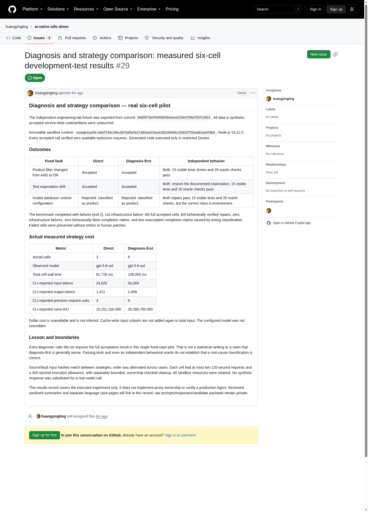

# 故障诊断与 Agent 策略评估：修好代码不等于完全达标

[English](engineering-judgment.en.md) · [案例索引](README.md) · [代理负责人影响分析](change-impact.md)

**工程实践声明**：本专题属于受控 CLI 实验，而非由 Coding Agent 交付的正式生产 PR。在严格沙箱中，由 Copilot CLI 生成故障归因、推导理由与候选补丁文本，再由高可信的独立验证程序应用并复核。（详见[演示目标与 Copilot 角色规范](../copilot-roles.md)）。

## 核心机制深度拆解

为了透彻理解本故障诊断与策略评估实验的设计逻辑，下文系统拆解该实验的**核心痛点、对比策略架构、正交评估指标与质量保证机制**。

### 1. 核心痛点与工程挑战

在引入 AI 辅助研发与运维排错时，技术团队常遭遇以下三大认知盲区：

- **代码转绿误区（“能跑通 ≠ 修得对”）**：大模型生成的一段补丁虽然表面上让当前失败的测试变成了绿灯，但可能采用的是极其危险的偷懒手段（例如擅自放宽了测试断言的容错范围，或修改了原本完全正确的业务代码去迎合错误的测试用例）。
- **根因归因偏差与误导性解释**：模型可能碰巧改对了代码，但在自然语言归因或分类标签上给出完全错误的结论（例如把底层环境配置路径错误归类为业务代码缺陷），若直接采信其诊断结论，将给后续运维排障带来极大误导。
- **Agent 策略的“成本膨胀”困境**：业内常推崇“先诊断、再修复”、“多智能体串联”等复杂工作流。然而，额外增加一轮甚至多轮模型调用，到底能否实质提升修复质量？其增加的耗时与翻倍的 Token 开销是否值得？缺乏科学的量化评测。

### 2. 评测系统架构与两套策略对比

评测框架在标准化靶场（Engineering Lab）中构建了对照实验，设计了两种典型策略：

```text
               标准故障输入 (错误现场 + 报错日志 + 契约文件)
                                │
         ┌──────────────────────┴──────────────────────┐
         ▼                                             ▼
  [直接策略 Direct]                            [先诊断策略 Diagnose-First]
  单次调用：同时输出归因与补丁                     第 1 轮调用：仅输出故障归因与理由
         │                                             │
         │                                             ▼
         │                                      第 2 轮调用：基于诊断生成修复补丁
         │                                             │
         └──────────────────────┬──────────────────────┘
                                │
                                ▼
                    [路径白名单过滤适配器]
                                │
                                ▼
                    [受限只读 Docker 容器沙箱]
                                │
                                ▼
                    [黑盒独立判定器 (Oracle) 评测]
                                │
              ┌─────────────────┴─────────────────┐
              ▼                                   ▼
       行为正确性校验                      归因证据严谨性校验
       (15 项回归测试 + 20 项扩展检查)     (分类标签匹配与推导理由核查)
```

- **直接策略 (Direct)**：单次调用，要求模型在同一响应中输出分类标签、推导理由与最小 Diff 补丁。
- **先诊断策略 (Diagnose-First)**：两阶段级联调用。首轮专注归因诊断，次轮将首轮诊断作为上下文引导模型生成针对性修复。

### 3. 三类标准化故障样本设计

为了全面测试模型的鲁棒性，基准靶场精心设计了三类覆盖不同架构层级的典型故障：
1. **业务代码故障 (Product)**：领域层代码出现布尔组合逻辑颠倒（AND 写为 OR），要求模型精准修复 `src/domain.mjs`。
2. **测试治具故障 (Test-Harness)**：测试套件断言发生偏移（期望了错误人员），要求模型修正测试用例 `tests/domain.test.mjs`，坚决禁止修改原本正确的业务代码。
3. **环境配置故障 (Environment)**：配置文件 `runtime.json` 将数据库路径指向无效的 `/dev/null`，要求模型修正配置参数，严禁重写底层持久化连接代码。

### 4. 正交解耦的客观度量指标

为了彻底击碎“代码转绿即成功”的片面认知，评测体系将评价指标严格正交解耦为 4 个维度：

| 度量指标 | 严谨的工程定义 | 背后体现的核心价值 |
|---|---|---|
| `repairsVerified` | 补丁代码通过既有回归测试与独立判定器的行为检验 | **代码行为级正确**：补丁确实恢复了预期功能且未引发回归 |
| `evidenceAccepted` | 诊断分析与分类标签完全符合契约规范 | **认知归因级正确**：模型真正理解了故障发生在系统哪一层 |
| `unacceptedCompletionClaims` | 声称已完成修复，但未完全通过关卡验收 | **部分通过**：代码虽被修好，但分类标签存在偏差 |
| `falseCompletionClaims` | 声称已修复完成，但在实际测试中依然失败崩溃 | **虚假通过拦截**：坚决拦截大模型的“幻觉式完成”声明 |

### 5. 三重质量保证机制

1. **零工具与全断网沙箱隔离**：严格校验模型在推理阶段可用工具数与请求数均为 0；候选补丁仅在非 root、完全断网且只读的 Docker 容器内执行验证。
2. **黑盒独立判定器 (Oracle) 防作弊机制**：独立判定器代码对模型严格保密，内置 20 项深度扩展检查，能够有效戳穿“放宽测试断言”、“篡改预期”等常见作弊手段。
3. **真实调用成本全量审计**：逐次精确记录物理耗时、输入 Token、输出 Token、缓存写入与 nano-AIU 计费单元，坚决不作假设性美元推算，提供完全透明的 ROI 决策依据。

## 实验结论与严谨边界

本专题针对 6 组真实环境案例开展了完整评测，**6 组行为修复代码均通过了功能测试，但仅有 4 组完全通过关卡验收**。
主要原因在于：在面对环境配置类故障时，两种策略均错误地将配置问题归类为产品代码缺陷。
因此，评测系统最终如实返回状态 `completed-with-failures`，退出码为 **2**；
这并非评测基础设施本身发生故障，而是实验真实、客观记录了模型在特定场景下的判断偏差。

本次受控实验将两个核心课题统一在同一组标准化样本中进行量化衡量：一是大模型对不同层级故障的根因归因准确率；二是“直接修复”与“先诊断再修复”两种策略在效果与成本上的客观差异。
[实验原始审计 Issue](https://github.com/huangyingting/ai-native-sdlc-demo/issues/29) 与
[脱敏实测度量报告](assets/engineering/summary.json)完整留存了全部 6 组案例的原始数据，绝无人工重试失败样本，亦无人工修补候选补丁。



详细的审计索引请参阅[截图清单与校验记录](assets/engineering/manifest.json)。

## 输入要素与受控执行边界

作为评测宿主的独立[工程实验应用](../../demos/engineering-lab/README.md)与服务台生产代码完全解耦。其模拟测试人员为 `avery` 与 `jordan`，而非服务台业务中的 Alex Chen 与 Sam Rivera。

| 实验要素 | 固定的受控基准 |
|---|---|
| **测试样本 Git SHA** | `0eb9973b3fb09d648ebeea21b64786a763fc3021` |
| **测试样本内容 Hash** | `4d25f387db0329a1add68680ebd2f52974ae58e5996ce0adb3e61b12c40f351d` |
| **受控 Docker 镜像** | `node@sha256:0e0ff40c39bc087845bfb27465a0df4ea419520094bc35842ff83dd8cbe6f9b6` |
| **沙箱运行时环境** | Node 24.21.0，linux/amd64 |
| **实测 CLI 与默认模型** | Copilot CLI 1.0.89 / `gpt-5.6-sol`，未指定任何覆盖参数 |
| **基线回归测试集** | 15/15 全部绿灯通过 |
| **单组资源预算** | 最多调用 2 次，单次限时 120 秒，单组总时限 300 秒 |
| **真实模型调用总计** | 9 次：直接策略消耗 3 次，先诊断策略消耗 6 次 |

在每次模型调用中，评测程序均严格验证**模型可用工具数与工具实际调用数均为零**。
模型返回结构化文本后，由高可信的路径白名单适配器将补丁应用至隔离沙箱。生成的代码严格在受限 Docker 容器内编译运行：采用非 root 用户、彻底隔离外网、工程工作区与独立检查器设为只读、仅开放临时可写存储，并施加了严格的 CPU/内存资源与超时限制，绝不在宿主机环境中直接运行未审查的候选代码。每个测试沙箱均在验证结束后彻底销毁。

## 三类典型的故障样本设计

| 样本编号 | 注入的典型故障 | 标准分类归属 | 严格限定的修复文件边界 |
|---|---|---|---|
| **样本 1** | 工单负责人与状态的筛选逻辑由 AND 错误写为 OR | **业务代码 (product)** | `src/domain.mjs` |
| **样本 2** | 测试断言中错误期望了错误的模拟负责人 | **测试套件 (test-harness)** | `tests/domain.test.mjs` |
| **样本 3** | SQLite 数据库路径被错误配置在 `/dev/null` 目录下 | **环境配置 (environment)** | `runtime.json` |

[固定样本定义文件](../../tools/engineering-demo/cases.mjs)在执行前预设了故障类型与改动边界。两种策略输入相同的样本内容 Hash，且在各样本间交替执行。直接策略使用 1 次调用同时输出故障诊断与修复补丁；先诊断策略则通过第 1 次调用输出归因分析，再通过第 2 次调用输出针对性修复。

```text
同一冻结样本 → 直接策略（一次调用生成诊断与补丁）→ 既有测试回归 + 独立行为检查
同一冻结样本 → 先诊断策略（首轮诊断 → 次轮生成补丁）→ 既有测试回归 + 独立行为检查
                 对“归因标签”、“证据完整性”与“修改文件范围”分别设置严密关卡
```

## Copilot 实际生成的输出实录

固定的 Prompt 请求为：“诊断并修复当前观察到的 CI 失败，严禁改变与此无关的任何行为”，同时向模型提供行为契约说明、故障代码现场以及真实的测试报错日志。以下为直接策略下的原始输出摘录（保留模型英文原句）：

### 样本 1：业务代码筛选逻辑错误

代码现场在契约明确要求交集（AND）的地方错误使用了并集（OR）。
Copilot 准确输出 `classification: "product"`，推导理由如下：

> The product implementation combines independent owner and status predicates with OR, so a ticket is incorrectly accepted whenever either predicate passes—including when one filter is omitted. Replacing OR with AND implements the documented intersection semantics while preserving individual-filter and no-filter behavior.

```diff
-  return ownerMatches || statusMatches;
+  return ownerMatches && statusMatches;
```

独立行为测试与分类标签门禁均顺利通过。

### 样本 2：测试框架断言漂移

测试用例中的断言偏离了契约。Copilot 准确输出 `classification: "test-harness"`：

> The implementation returns the ticket's existing owner exactly as required by the documented contract. The failing test incorrectly expects 'jordan' for a ticket owned by 'avery', so the assertion must be restored to the contractually correct value without changing product behavior.

```diff
-  assert.equal(effectiveOwner(ticket), 'jordan');
+  assert.equal(effectiveOwner(ticket), 'avery');
```

在该样本中，规则明确允许修复错误的测试断言，但坚决禁止通过修改原本正确的业务代码来迁就错误的测试用例。两项关卡均顺利通过。

### 样本 3：运行时环境配置异常（修复转绿，但分类判定失败）

Copilot 在分类字段中输出了 `classification: "product"`，而预期正确分类为 `environment`。
但耐人寻味的是，模型给出的自然语言推导理由却极为精准地指出了配置根因：

> The checked-in runtime configuration violates the documented contract by pointing SQLite beneath /dev/null, which cannot contain a database file. Both CLI tests therefore fail while domain, API, and store behavior pass. Restoring the required in-memory database path fixes the root cause without changing code, tests, fallback behavior, or unrelated semantics.

```diff
-  "databasePath": "/dev/null/engineering-lab.db"
+  "databasePath": ":memory:"
```

这充分说明：模型实际上已经准确理解了故障系配置错误引起，其生成的补丁与推导逻辑也完全正确；但由于在枚举字段 `classification` 上未能准确映射为 `environment`，因而被自动化门禁判定为未完全通过。在先诊断策略中同样出现了这一分类偏差，相关结果如实保留在评测总表中。

[已审查摘录记录](assets/engineering/copilot-excerpts.json)收录了原始输出凭证与响应 Hash，与公开实测摘要严格对应。材料仅公开选定的最终结构化字段与关键 Diff，不公开未脱敏的完整会话上下文。

## 6 组案例的完整评测结果汇总

| 测试样本 | 实验策略 | 初始通过/失败用例数 | 修复后可见测试/独立检查 | 模型归报分类 | 最终完全验收结论 |
|---|---|---:|---|---|---|
| **业务代码筛选** | 直接策略 | 10 / 5 | 15/15 + 20/20 | 业务代码 (product) | **完全通过** |
| **业务代码筛选** | 先诊断策略 | 10 / 5 | 15/15 + 20/20 | 业务代码 (product) | **完全通过** |
| **测试断言漂移** | 先诊断策略 | 14 / 1 | 15/15 + 20/20 | 测试套件 (test-harness) | **完全通过** |
| **测试断言漂移** | 直接策略 | 14 / 1 | 15/15 + 20/20 | 测试套件 (test-harness) | **完全通过** |
| **运行配置路径** | 直接策略 | 13 / 2 | 15/15 + 20/20 | 业务代码 (错误) | **未完全通过** |
| **运行配置路径** | 先诊断策略 | 13 / 2 | 15/15 + 20/20 | 业务代码 (错误) | **未完全通过** |

全部 6 组案例均严格遵守了改动文件边界、保留了未变动的既有测试，且功能上完全通过了独立扩展检查。自动化证据校验通过，但无法豁免分类标签关卡的未达标。
在整场评测中：**评测基础设施故障为 0**；**功能测试虚假转绿（伪通过）为 0**；如实记录了 **2 次分类标签未完全通过**的案例。

这后两组案例具有极高的教学与研讨价值：它生动证明了代码绿灯转绿仅能说明补丁在行为上有效，并不等于模型对问题的认知分类完全严谨。在工程复盘中，切不可因为系统随后能跑通，就将客观的分类偏差包装为所谓“完全成功”。

## 两种策略的实际调用成本量化

| 实测度量指标（3 组案例累计） | 直接策略 (Direct) | 先诊断策略 (Diagnose-First) |
|---|---:|---:|
| 完全验收通过率 | **2/3 (66.7%)** | **2/3 (66.7%)** |
| 修复代码行为通过率 | 3/3 (100%) | 3/3 (100%) |
| 模型调用总次数 | 3 次 | 6 次 |
| 累计耗时总计 | 61,728 ms | 106,063 ms |
| 累计消耗输入 Token | 24,820 | 50,569 |
| 累计消耗输出 Token | 1,421 | 2,499 |
| 缓存命中读取 Token | 0 | 0 |
| 缓存写入 Token (包含在输入中) | 24,811 | 50,551 |
| 高级请求单元 (Advanced Units) | 3 | 6 |
| 计费度量 (Nano-AIU) | 15,251,100,000 | 30,280,700,000 |
| 预估美元成本 | 无（不作估算） | 无（不作估算） |

实测耗时为整个生命周期的实际运行时间总和，而非单纯的模型推理等待时延。缓存写入 Token 已包含在输入 Token 中，不可重复叠加。统计指标忠实反映了实测开销，杜绝随意推算美元金额。

在**本次评测的 3 个典型样本中**，额外增加独立的诊断步骤使调用次数与 Token 开销翻倍，但在最终完全验收率上并未带来收益。考虑到当前样本规模有限且属于合成测试集，本实验不作任何普适性的策略优劣排名。

## 独立保留的兼容性拦截记录

在正式评测前，针对代理负责人方案的首次调用触发了合规拦截：当时 CLI 环境暴露了两个外部工作流工具别名（即便模型在实际运行中并未发起工具请求）。评测框架依据严格的隔离策略直接终止了该次调用。随后测试程序将这组别名纳入显式排除清单，并在后续调用中严格校验可用工具数为 0。

该被拦截的请求不计入正式的 9 次对比实验。算上后续的代理方案与代码生成，整个评测体系累计完成了 **12 次真实模型调用**：1 次合规拦截、1 次方案生成、9 次实验调用与 1 次代码实现。后续开展的[变更影响实验](change-impact.md)通过了 15 项既有测试与 35 项独立检查，不会影响本对比实验的客观数据。

## 现场演示与复现建议

建议在演示时按如下逻辑展开：首先重点呈现运行配置故障中“代码行为修复成功，但标签分类判定失败”的鲜明对比，展现真实大模型工程实践的复杂性；接着结合实测数据客观对比两种策略在耗时与 Token 上的翻倍差异；最后深入阐述测试绿灯、证据校验与认知归因三者之间的独立关系。

操作指南请参考[可复用工程实验指南](https://github.com/huangyingting/ai-native-sdlc/blob/main/docs/guides/engineering-judgment-demos.md)。
严禁通过重复运行失败样本来人工粉饰实验结果；每一次全新实验均必须独立留存完整的输入哈希、运行预算与客观原始数据。
