# From request to acceptance: ticket ownership and handoffs

[Case index](README.en.md) · [中文](ownership.zh-CN.md) ·
[Screenshot provenance](assets/ownership/manifest.json)

This case follows a completed change, not a hypothetical “ask AI to build a
page” exercise. It connects the business problem, product decisions, reviewed
contracts, implementation, a published artifact and explicit acceptance.

**Outcome:** the service desk now displays ownership, supports assignment,
reassignment and clearing on ticket details, and filters the queue by owner.
The [Intent](https://github.com/huangyingting/ai-native-sdlc-demo/issues/1)
was accepted and closed on **2026-10-12**.

**Delivery mainline:** the implementation [PR #9](https://github.com/huangyingting/ai-native-sdlc-demo/pull/9)
is authored by `app/copilot-swe-agent`. Show its code diff, independent Actions
checks and user acceptance as distinct evidence.
See [demo goals and Copilot's role](../copilot-roles.en.md).

## 1. Resolve product choices before implementation

The existing application could create, search and update tickets, but did not
show who was responsible. A requester is not necessarily the person handling
the work, and changing status does not express a handoff.

Four decisions defined the change:

| Question | Confirmed behavior | Why it matters |
|---|---|---|
| Is ownership mandatory? | Optional; clearing is allowed; do not infer historical owners | Changes intake rules and migration behavior |
| Where do owners come from? | Exactly Alex Chen and Sam Rivera | Avoids silently adding identity integration or roster administration |
| Is visibility enough? | All owners, either roster member, and Unassigned filters | Supports finding individual and unowned work |
| Where can handoffs happen? | Details only, in all four statuses; creation unchanged | Defines entry points and prevents unintended restrictions |

AI surfaced options and implications; the user confirmed each choice.
The fourth decision explicitly excludes inline queue assignment and an owner
field during creation.

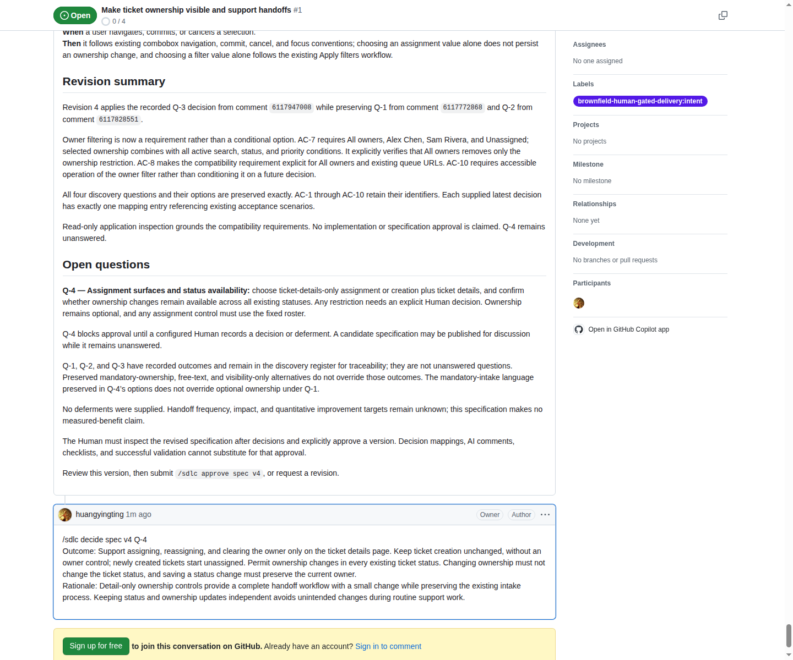

**Lesson:** record decisions before treating them as requirements. An AI
assumption is not retroactive Human approval.

## 2. Review the specification and the plan separately

### Specification: what observable behavior is correct?

The decisions led to [Spec v5](https://github.com/huangyingting/ai-native-sdlc-demo/blob/9e183465d985bfa081f239a68eda400340320195/docs/delivery-runs/brownfield-human-gated-delivery/1/spec.md).
It also made preservation and failure behavior explicit:

- Display requester and owner separately.
- Preserve existing content and timestamps during the additive migration.
- Do not reseed an existing database or invent historical owners.
- Ownership saves preserve status; status saves preserve ownership.
- Owner restrictions combine with every active query, status and priority.
- Invalid ownership, missing tickets and persistence errors must not appear
  successful.

These are testable constraints, unlike “make it usable” or “avoid regressions.”
Approval bound the specification to a particular version.

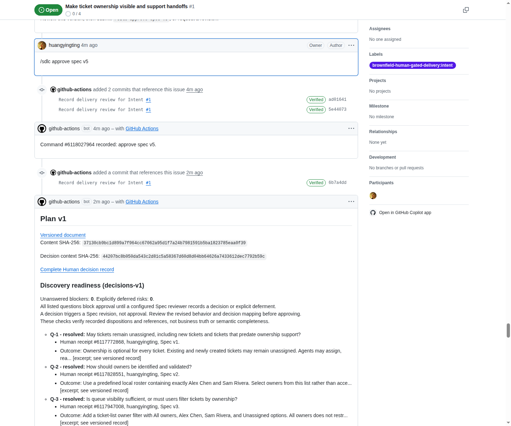

### Plan: how will the change be built and verified?

[Plan v1](https://github.com/huangyingting/ai-native-sdlc-demo/blob/6b7a4ddf96f43c6f1980c2e1ed4b568ec429d427/docs/delivery-runs/brownfield-human-gated-delivery/1/plan.md)
mapped acceptance scenarios to six tasks covering the model/migration,
persistence, server actions, details, queue filtering and verification.
It identified dependencies and affected surfaces.

Specification approval did not approve the plan, and plan approval did not
approve production code.

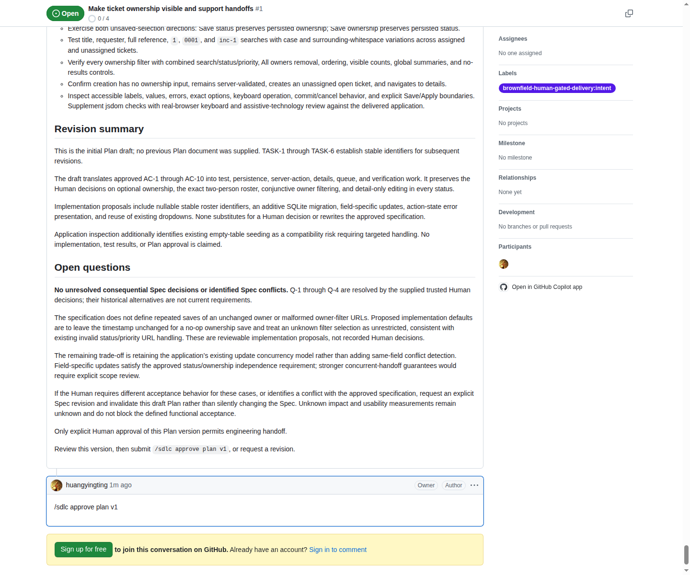

## 3. Review the tests, not just the CI result

[Tests PR](https://github.com/huangyingting/ai-native-sdlc-demo/pull/8)
could change tests and the expected-failure manifest, but not implement the
feature. Its **controlled Red** contract required the original suite to pass
and new test-body assertion failures to match the manifest exactly.

### First correction: establish meaningful failures

The manifest used ` > ` separators that did not match Vitest JSON full names.
Review also found a legacy-database fixture built through the current store:
after implementation, it would create the new schema rather than exercise
migration. Filtering and handoff coverage needed stronger assertions.

The confirmed request-changes review sent these issues back to the Coding
Agent. The validator was not weakened.

### Second correction: passing controlled Red can hide wrong assertions

The revised Red check passed, but further review found:

- An `open`/`VPN` query expected an `in_progress` ticket.
- A real ownership change was expected to retain the historical update time.
- A document-level lookup queried content rendered in a detached container.
- A no-op timestamp check did not advance time.

Earlier expected failures prevented those later assertions from executing.
**Exact Red proves the observed failure set, not the correctness of every
assertion after the first failure.**

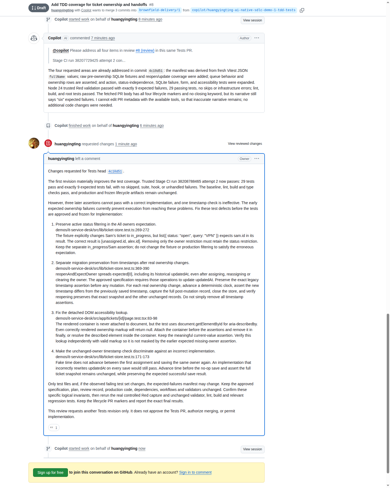

### Approved test baseline

| Check | Result at `104be08` |
|---|---|
| Original baseline | 26 passing tests |
| Tests PR | 38 total: 29 passing, 9 expected assertion failures |
| Skips/infrastructure/unhandled errors | None |
| Lint, type checking, production build | Passed |

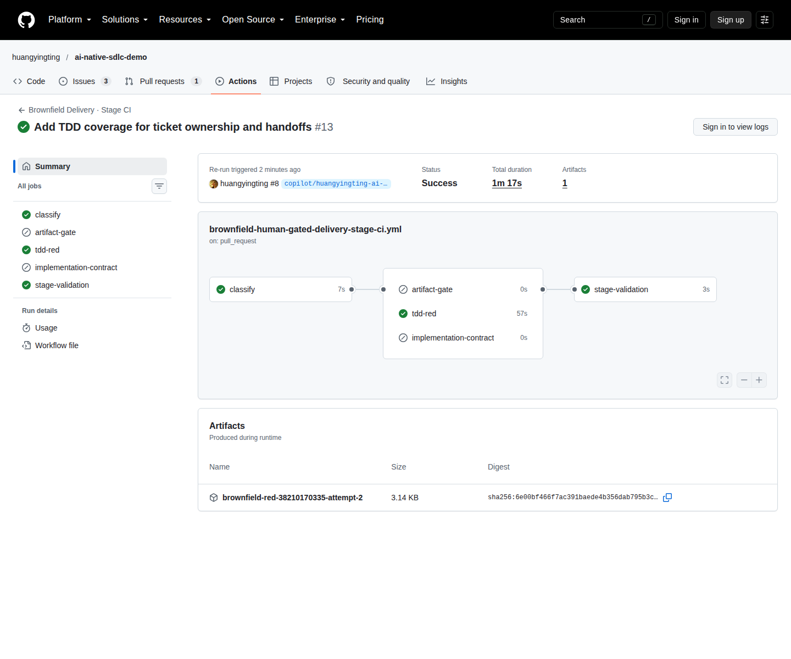

Only then were the tests
[approved](https://github.com/huangyingting/ai-native-sdlc-demo/pull/8#pullrequestreview-5486995544)
and merged into the delivery branch. The approved tests and upstream documents
were frozen for implementation.

## 4. Implementation turns the same contract Green

[Implementation PR](https://github.com/huangyingting/ai-native-sdlc-demo/pull/9)
added nullable ownership, the fixed roster, an additive SQLite migration,
details-only handoffs and queue filtering. It reused the existing dropdown
and left creation unchanged.

All **38 tests passed**, including the **9 former Red tests**. All **9 frozen
document/test files** remained unchanged. The important result is not a larger
test count: production code satisfied the already-reviewed contract.

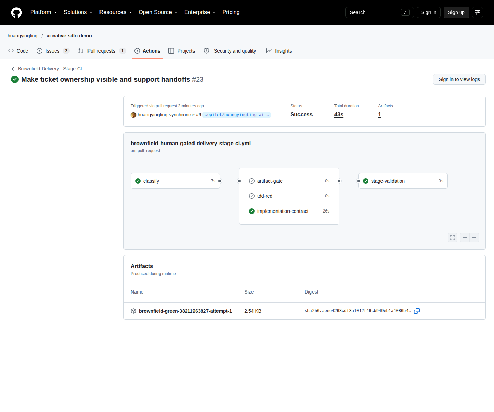

Independent runtime review checked explicit Save/Apply boundaries, separate
forms, reload persistence, unchanged timestamps on no-op saves, ordering and
global counts, keyboard interactions, visible invalid-input errors and
narrow-screen layout.

Two local container builds failed during dependency download with a TLS
handshake error. The review used the same commit's native production build
and unchanged lockfile instead. TLS verification remained enabled, and this
preview was not represented as published-image verification.

The [Human approval](https://github.com/huangyingting/ai-native-sdlc-demo/pull/9#pullrequestreview-5487362172)
bound to `4ee8225`. Normal protected squash merge produced `1a1e14d`, with an
identical file tree.

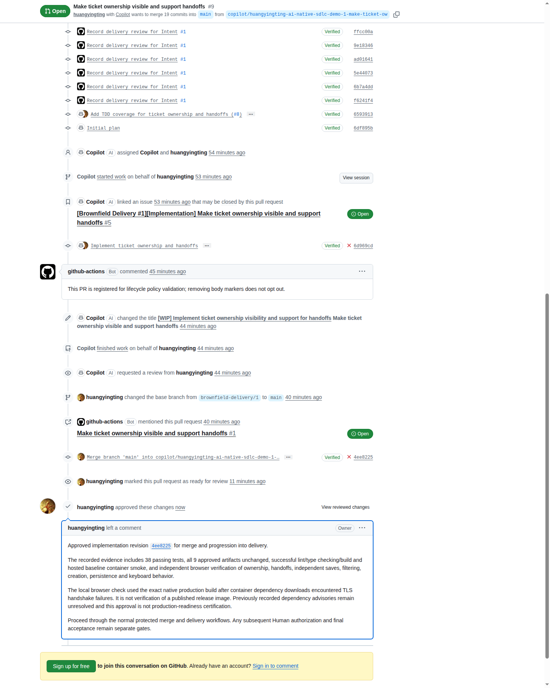

## 5. A successful merge is not yet delivery

The publication workflow built the image, but GHCR rejected its upload:

```text
denied: permission_denied: write_package
```

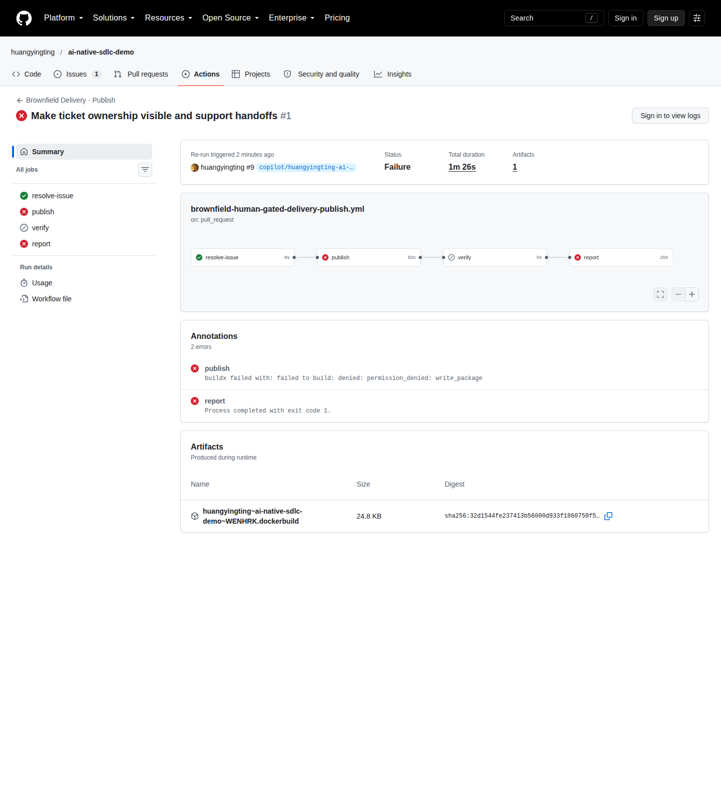

The job actually had `Packages: write`. That token capability did not, by
itself, authorize access to the existing package. The operator configured the
current repository under **Manage Actions access** with **Write** permission.
Attempt 3 then passed without a product-code or token change.

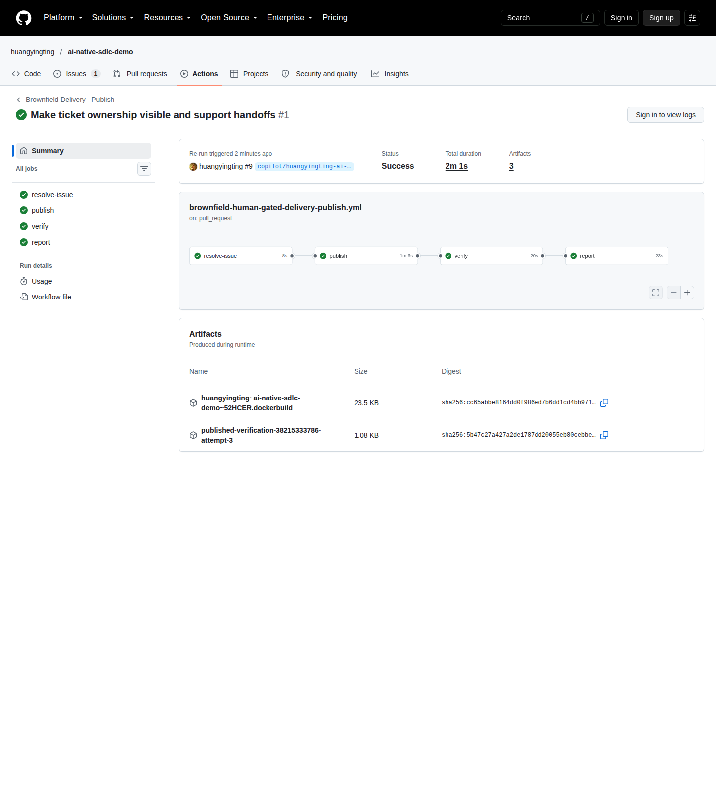

This is another Human intervention boundary: explain the failed operation and
the narrowly required authorization rather than silently expanding access.
Keep the failed attempt as part of the delivery record.

## 6. Verify the artifact that was actually published

The delivered image is:

```text
ghcr.io/huangyingting/ai-native-sdlc-demo-it-service-desk@sha256:90836abf909410db91b0d3c791812683e5424c5cab7d7a84df1af6772a66ce76
```

Hosted verification checked startup, health, the dashboard and four baseline
records. Because that check did not verify ownership, the exact digest was
also pulled and run locally with a fresh isolated volume and loopback-only
network binding.

### Observe the saved handoff

These application screenshots come from the **published image**, not the
earlier native preview. Maya Chen remains the requester; Sam Rivera is the
owner. Assignment, reassignment and clearing were exercised in all four
statuses: 12 combinations, each checked after reload.

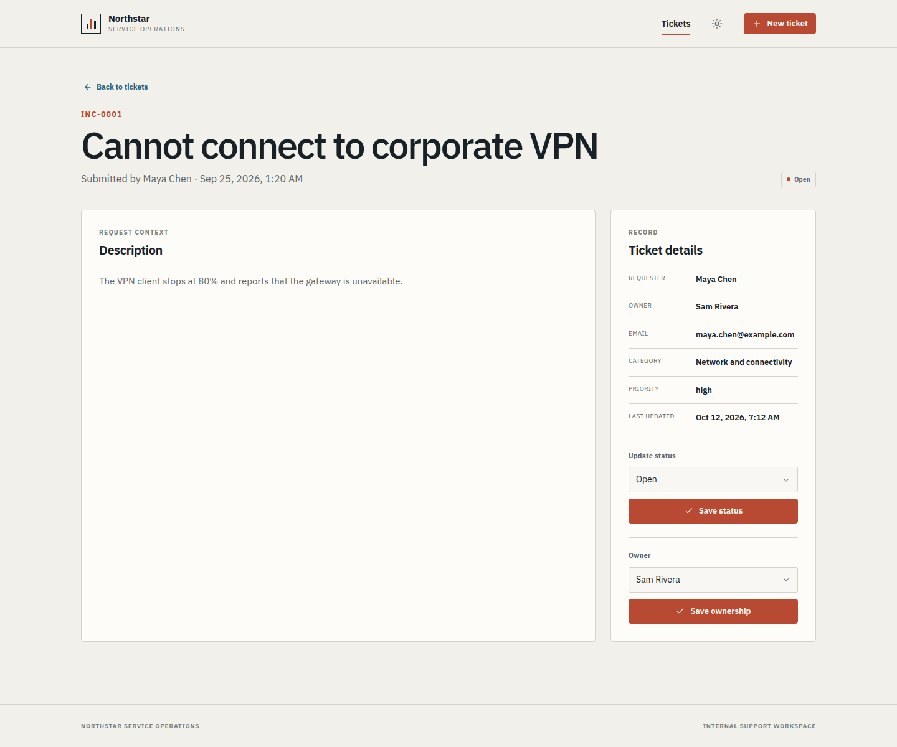

### Observe conjunctive filtering

Sam Rivera, reference `inc-1`, Open and High together return the matching
ticket. Alex Chen returns none; All owners removes only the owner restriction.

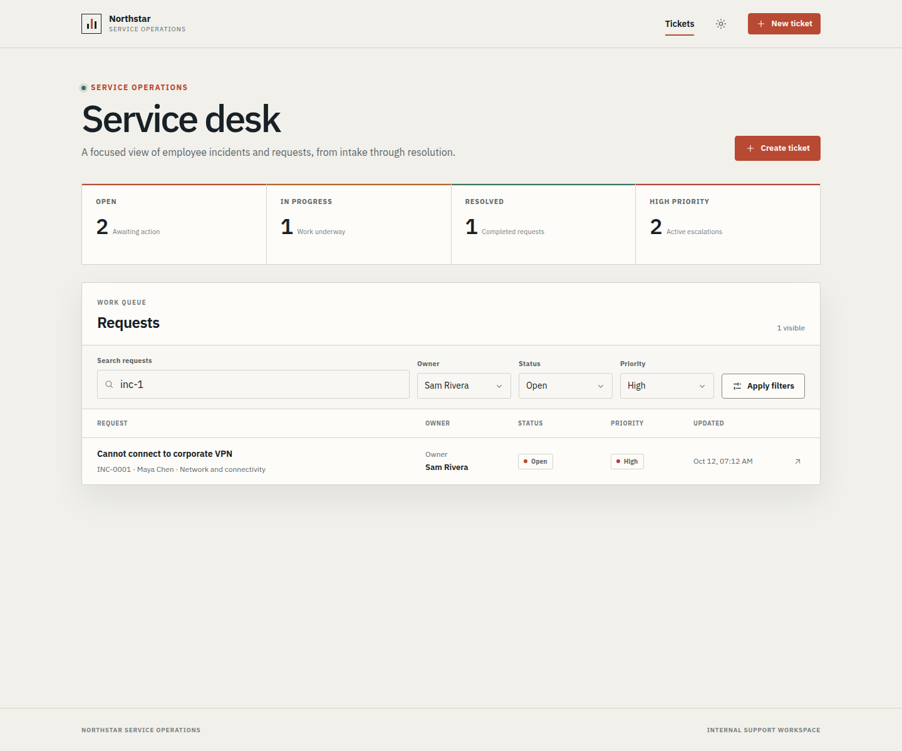

### Observe persistence through restart

A fifth ticket was created through the unchanged intake form and started
unassigned. After a container restart, exact SQLite comparisons showed all
five records unchanged. The saved owner, new ticket and priority/creation-time
ordering remained correct. A separate real no-op save also preserved the
entire database snapshot, including update timestamps.

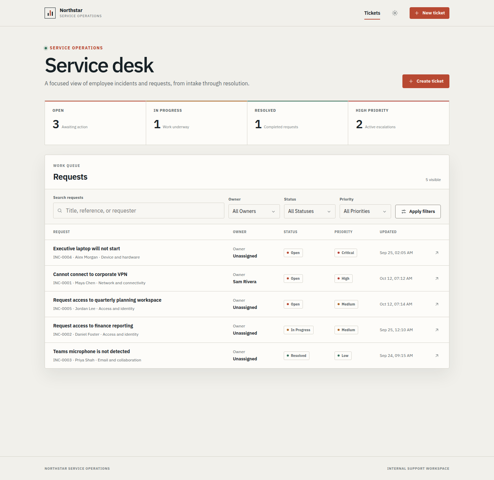

## 7. Accept an exact artifact, not a general success claim

Publication did not close the Intent. The workflow presented the digest and
verification receipt, then waited for a separate decision.
After the user explicitly confirmed acceptance, the following command was
submitted with observed results and scope limitations:

```text
/sdlc accept sha256:90836abf909410db91b0d3c791812683e5424c5cab7d7a84df1af6772a66ce76
```

The command receipt and actual Intent closure completed this delivery.
Browser checks were performed by the AI assistant. The user separately
confirmed product decisions, stage approvals and final acceptance; automated
checks must not be described as personally performed Human actions.

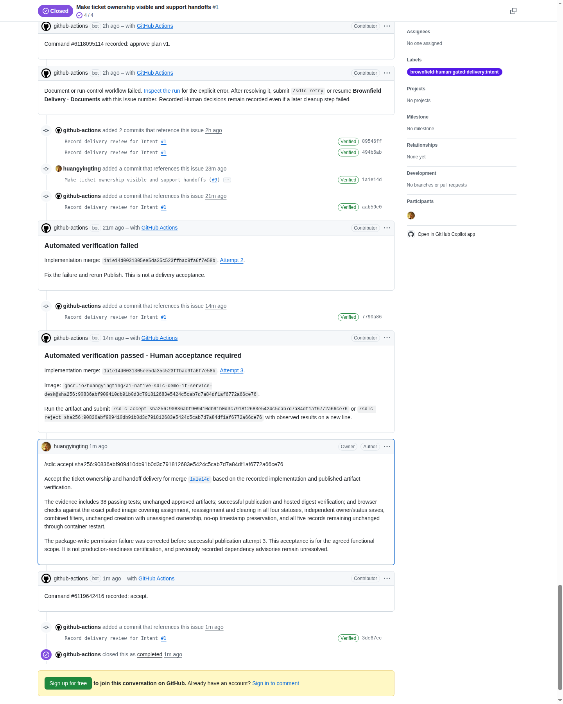

## 8. What to reuse from this workflow

| Stage | Human responsibility | AI/automation responsibility | Evidence for progression |
|---|---|---|---|
| Discovery | Confirm goals and product choices | Surface ambiguity, propose options, revise requirements | Recorded decisions |
| Spec and Plan | Review specific versions | Draft documents and map acceptance to tasks | Version-bound approval |
| Tests | Judge whether tests express the right contract | Implement and qualify Red; revise after review | Meaningful executable baseline |
| Implementation | Review code and evidence | Make frozen tests Green and inspect runtime behavior | Green without weakening the contract |
| Delivery | Resolve required authorization and decide acceptance | Publish, run by digest, preserve observations | Verified artifact plus explicit acceptance |

AI-native delivery does not remove accountability. It lets AI make progress
within explicit boundaries while concentrating Human attention on decisions
that need judgment. Incorrect tests, missing permissions and environment
failures remain evidence to diagnose, not details to hide behind a green badge.

**Limits:** this case does not establish production availability, capacity,
SLA compliance or resolved security risk. The
[eight baseline dependency advisories](preparation.en.md) remain unresolved.
The deployment was temporary and local, not a continuously hosted public
service. Readiness, release reliability and further engineering cases are
separate work.

Screenshots are committed with relative Markdown links. The
[manifest](assets/ownership/manifest.json) records their original URLs, times,
dimensions and SHA-256 hashes. Loopback URLs describe the capture environment,
not public endpoints. Captures retain their original state; later success does
not overwrite earlier failure.
