# 从进程存活到数据库就绪：一次已验收的维护交付

[English](readiness.en.md) · [案例索引](README.md) ·
[截图来源与校验记录](assets/readiness/manifest.json)

**已验收结果：**服务台现在能区分进程存活与当前工单数据库是否可读，
同时保持已验收的工单功能不变。
[需求 Issue #18](https://github.com/huangyingting/ai-native-sdlc-demo/issues/18)
在显式验收后关闭，时间为**北京时间 2026 年 10 月 13 日 06:38:35**
（`2026-10-12T22:38:35Z`）。

这是仓库 ID `1415043318` 中实际完成的交付，不是导入的历史结果，
也不是生产认证。后续[可靠性演练](reliability.md)已有两次通过记录，
维护审查仍待完成。

**这是交付主线：**实现 [PR #26](https://github.com/huangyingting/ai-native-sdlc-demo/pull/26)
作者为 `app/copilot-swe-agent`。Copilot 代码、Actions 验证和用户明确验收分别记录。
这不同于受限 CLI 附录；参照[演示目的与 Copilot 作用](../copilot-roles.md)。

## 1. 先观察问题，不预先指定答案

此前的工单负责人交付已经验收。两个运行同一已发布镜像的隔离实例说明了：
仅看进程存活，并不足以判断数据库是否可用。

| 请求 | 健康配置 | 无效数据库路径 |
| --- | --- | --- |
| `GET /api/health` | 200，`{"status":"ok"}` | 200，`{"status":"ok"}` |
| 工单列表页 | 200，存在列表标记 | 500，不存在列表标记 |
| `GET /api/ready` | 404 | 404 |

故障实例使用 `/dev/null` 下的路径，不挂载数据卷。
这是针对一次性资源的主动故障注入，不是生产事故，也不撤销此前的负责人功能验收。
没有客户影响或恢复时间的测量基线。


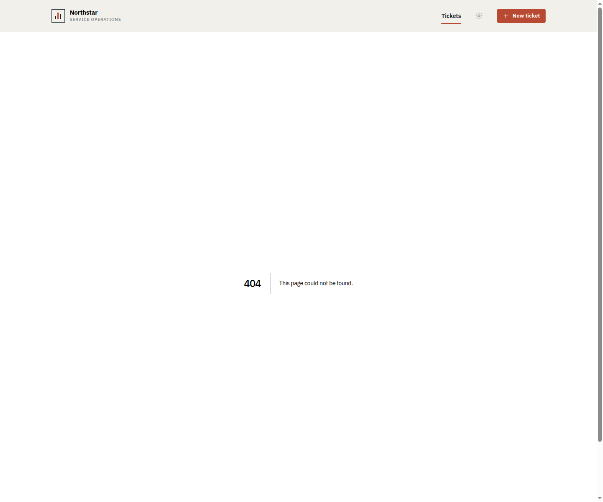

[英文维护需求](https://github.com/huangyingting/ai-native-sdlc-demo/issues/18)
保留产品讨论空间，没有把模型最初提出的接口约定当作已经批准的需求。

## 2. 一次记录六项决定，不等于一次批准六个阶段

原生批量决定允许一条命令记录多项探索结论。
[PR #23](https://github.com/huangyingting/ai-native-sdlc-demo/pull/23)
加入原子性批量命令，同时保留单项命令和独立的批准关卡。

[一条批量评论](https://github.com/huangyingting/ai-native-sdlc-demo/issues/18#issuecomment-6124226071)
针对 Spec v2 回答六个问题，只生成**一版 Spec v3**。
此前单独记录的 Q-1 回执作为被替代的历史继续保留。

| 问题 | 选定边界 |
| --- | --- |
| 探测能力 | 每次请求都通过已配置的共享存储，执行实际工单表的最小只读查询；已初始化的空表也健康 |
| 初始化 | 允许现有延迟初始化和真正新建数据库的种子数据，但保留已有记录、时间戳和空表 |
| HTTP 约定 | 200 `ready` 或 503 `unavailable`，JSON 和 `Cache-Control: no-store`；HEAD 实时检查但无正文；其他指定方法返回 405 且不探测 |
| 诊断与延迟 | 每次失败记录一个固定、脱敏事件；不承诺数值响应或锁等待期限，保留有负责人的后续工作 |
| 恢复 | 修正配置后重建实例；保留已填充存储，使用独立对照，验证真实 HTTP 和业务操作 |
| 信号含义 | 只证明当前数据库可读，不证明可写、完整应用健康或足以允许生产流量 |

失败值 `unavailable` 与现有探测工具一致。
冻结的探索问题仍保存历史建议 `unready`，真正有效的是记录的决定与验收场景，
不是旧选项。

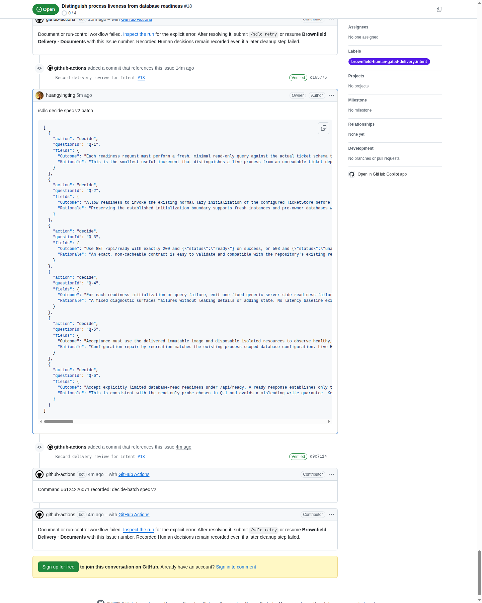

### 恢复工作流，但不抹去失败记录

批量决定已经成功记录，文档生成却超出原有 110 KB 请求上限：
完整命令正文被每个回答重复携带。
[PR #24](https://github.com/huangyingting/ai-native-sdlc-demo/pull/24)
对重复正文去重，没有丢弃决定，也没有提高上限。
修正后的实际请求为 **82,177 字节**。通过正常重试继续生成待发布修订，
没有重新提交整批决定。

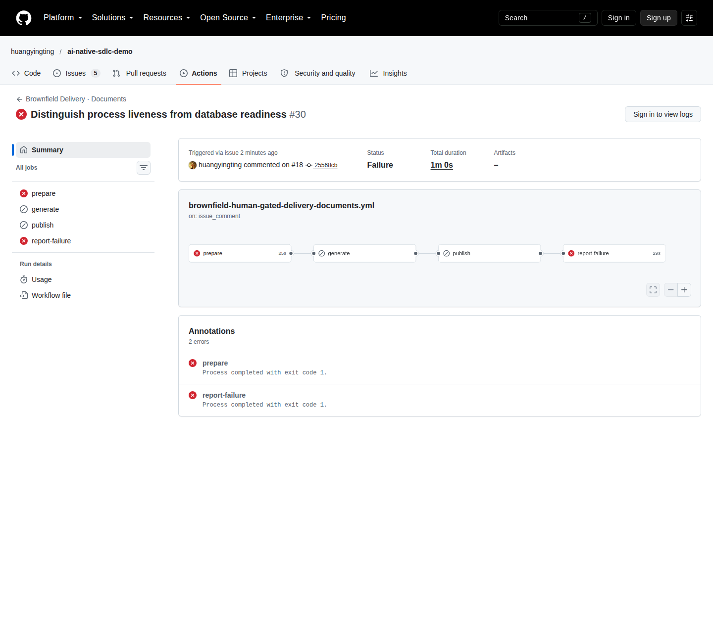

其他 GitHub API 失败也通过正常重试恢复。
丢失的评审分支只在获得授权并核对机器人证明的提交后恢复，
没有把未查明的分支消失原因说成已知事实。

## 3. 分别批准准确版本的规格和计划

[Spec v3](https://github.com/huangyingting/ai-native-sdlc-demo/blob/06e9fe31d5c00bb75a2438e49af00ea4fac8b134/docs/delivery-runs/brownfield-human-gated-delivery/18/spec.md)
包含九项验收场景。
[批准记录](https://github.com/huangyingting/ai-native-sdlc-demo/issues/18#issuecomment-6124496828)
绑定哈希 `15c4d4948968d6e1d96375dbe54c95452528368ab08096440e44b025655a0a3a`
及对应的决策上下文。

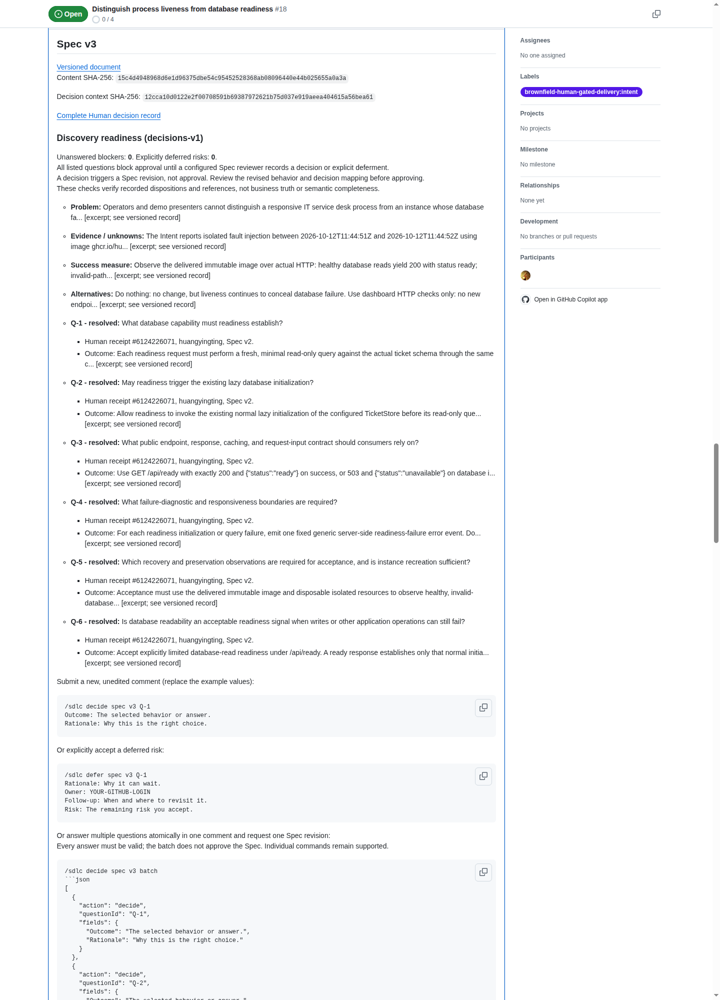

[Plan v2](https://github.com/huangyingting/ai-native-sdlc-demo/blob/06e9fe31d5c00bb75a2438e49af00ea4fac8b134/docs/delivery-runs/brownfield-human-gated-delivery/18/plan.md)
将这些场景映射到六项任务。
审查补充了精确的预期失败清单、实现前可正常收集的测试，以及保留数据卷的排他性交接。
冻结规格中的候选版本措辞，不会推翻可信状态中已经记录的批准。
[计划批准](https://github.com/huangyingting/ai-native-sdlc-demo/issues/18#issuecomment-6124971454)
与规格批准、之后的代码审查分别进行。

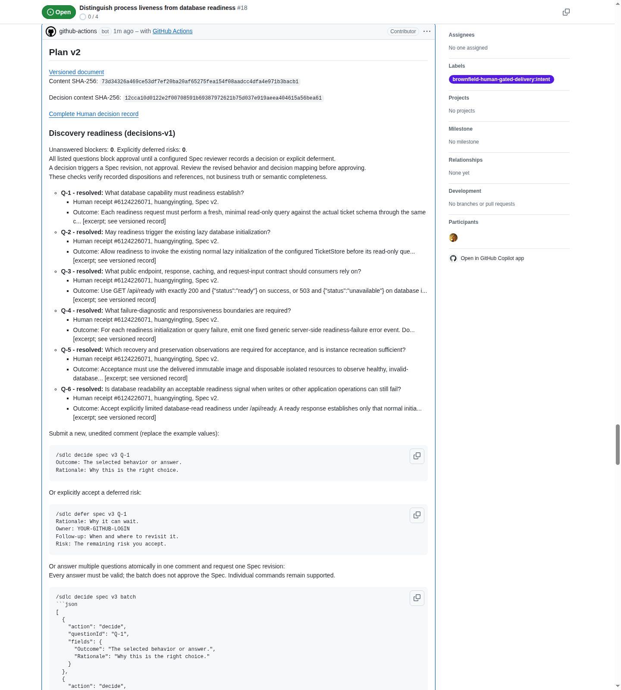

## 4. 审查 Red 测试究竟证明了什么

[测试 PR #25](https://github.com/huangyingting/ai-native-sdlc-demo/pull/25)
只修改三个测试文件和预期失败清单，不实现生产功能。
最初候选版本虽通过精确 Red，审查仍发现缺口：

- 热存储 GET 测试没有先发出成功的就绪请求，可能漏掉路由级成功结果缓存。
- 比较日志调用并转成 JSON，可能放过被序列化为 `{}` 的原始 `Error`，
  而真实日志仍会暴露异常。
- 除查询参数之外，还应检查 GET 正文读取方法没有被调用。

一轮修改补充了先成功、后失败、再恢复的断言，
初始化及 GET、HEAD 失败时的固定脱敏日志断言，以及正文读取保护。
八个获批测试的完整名称和预期失败清单保持不变。

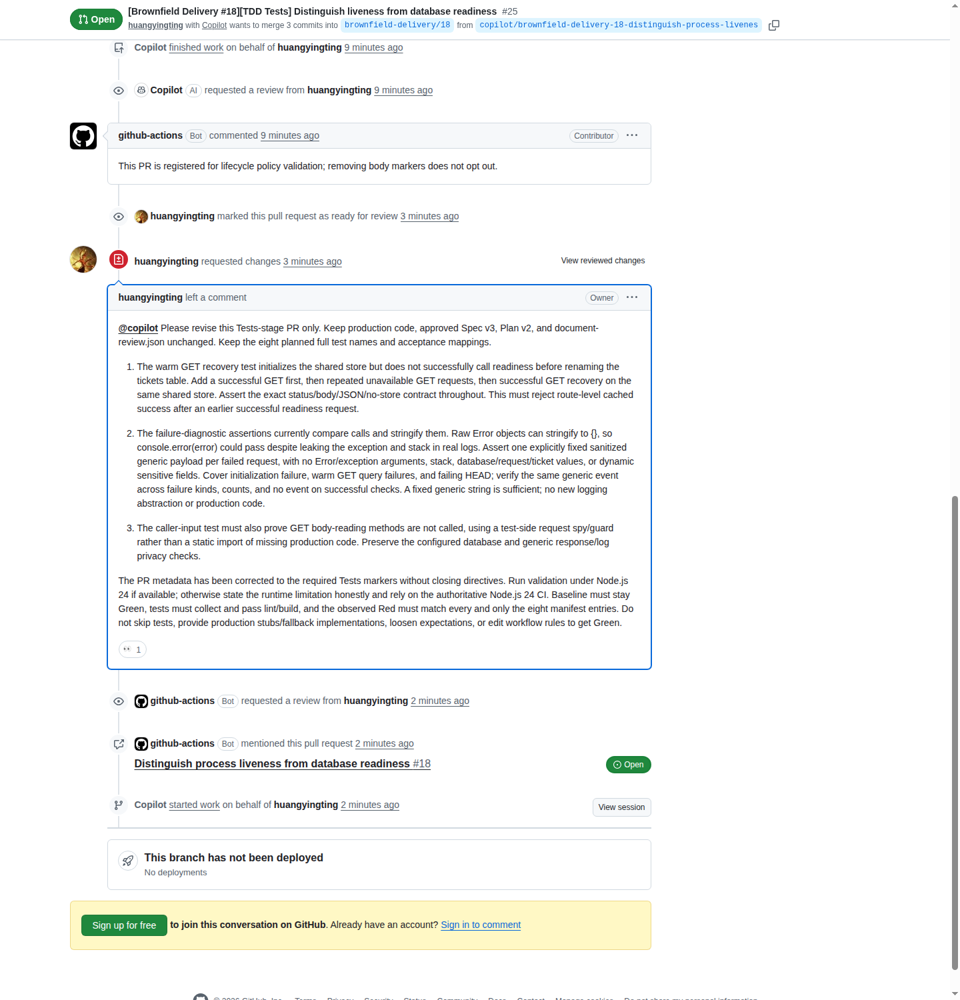

| Node.js 24 检查 | 实际结果 |
| --- | --- |
| 现有应用基线 | 38 项测试通过 |
| 已审查测试提交 `369c476` | 共 47 项：39 项通过，8 项精确匹配的预期断言失败 |
| 钩子、套件、未处理及意外错误 | 均为零 |
| 测试收集、lint、生产构建 | 通过 |

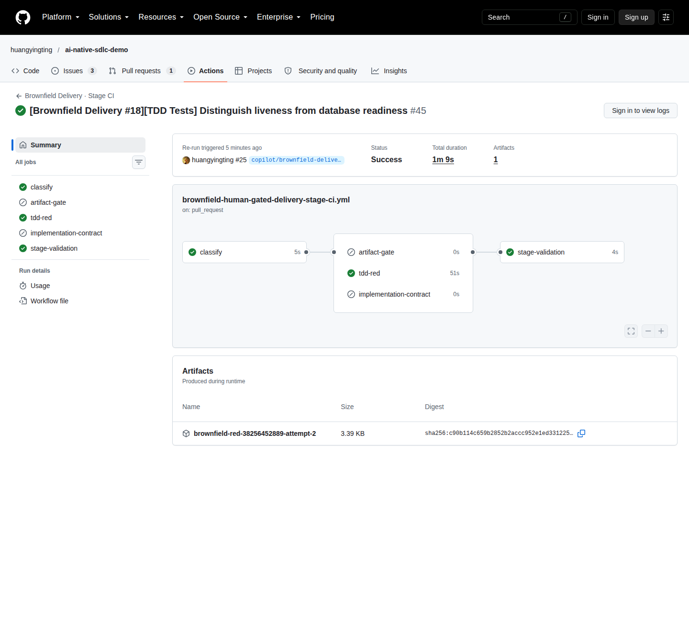

[显式测试批准](https://github.com/huangyingting/ai-native-sdlc-demo/pull/25#pullrequestreview-5491931657)
之后，保护规则下的压缩合并产生 `98178b7`，再交接实现任务。
同仓库 Copilot 运行通过维护者支持的重跑方式启动 CI；
这不是阶段批准，也不是绕过规则。

## 5. 让冻结的契约变成 Green

[实现 PR #26](https://github.com/huangyingting/ai-native-sdlc-demo/pull/26)
只增加两个生产改动面：`TicketStore.checkReadiness()` 和按请求执行的 Node.js 就绪路由。
固定查询 `SELECT id FROM tickets LIMIT 1` 不写业务记录，也不解释调用者传入的 SQL。

**47 项测试全部通过**，包括此前八项 Red 测试。
本次增量中的七个获批产物及测试文件保持逐字节一致。
额外的生产独立运行构建检查还完成了 37 项 HTTP 观察；
这些是候选实现证据，不是最终发布镜像验收。

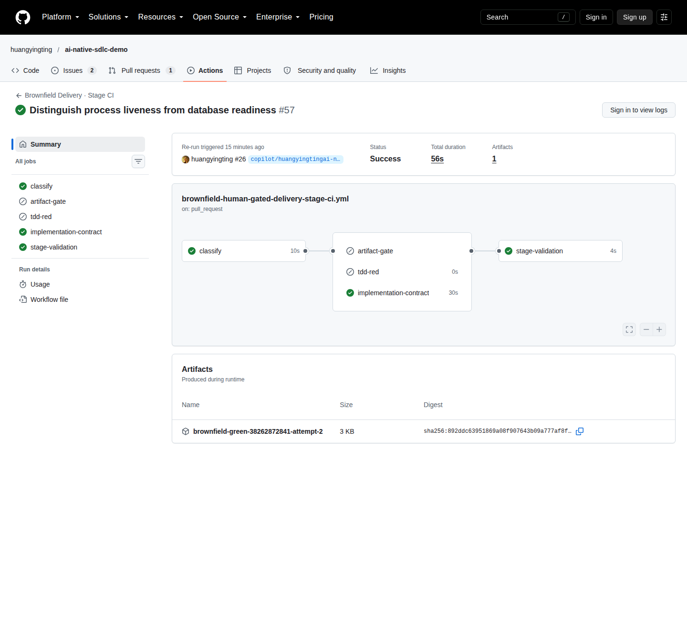

另一次本地 Docker 构建遭遇 npm TLS 下载错误，没有关闭 TLS 校验。
Docker CI 通过，额外本地 HTTP 检查使用同一源码的 Node.js 24 生产独立运行构建。

最终 PR 被重新指向 `main`。严格的最新基线保护要求同步两项此前已批准的批量工作流提交。
九个产品文件的 blob 保持一致。
GitHub 为仅同步基线的提交 `64406b5` 保留已有
[实现批准](https://github.com/huangyingting/ai-native-sdlc-demo/pull/26#pullrequestreview-5496196451)，
没有再次提交批准。新提交的 CI 通过后，正常保护流程压缩合并为 `06e9fe3`。

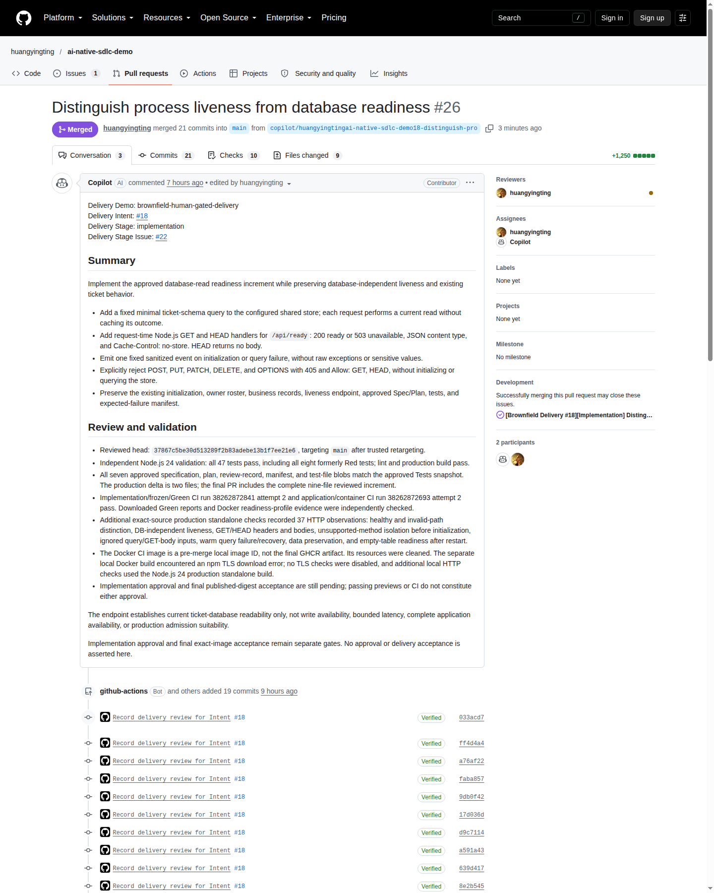

## 6. 验证发布摘要和真实恢复

[发布运行 38311999223，第 2 次执行](https://github.com/huangyingting/ai-native-sdlc-demo/actions/runs/38311999223/attempts/2)
发布并验证了：

```text
ghcr.io/huangyingting/ai-native-sdlc-demo-it-service-desk@sha256:84bff5d0817cafec6569b394b99eb92cc8b60e98b450bea9484992bcf11bc0d4
```

实际拉取镜像的 OCI 修订标签是合并提交
`06e9fe31d5c00bb75a2438e49af00ea4fac8b134`，来源标签指向本仓库。
[合并源码 CI](https://github.com/huangyingting/ai-native-sdlc-demo/actions/runs/38311998601)
也通过了全部 47 项测试。没有用可变预览标签或工作流名称代替产物身份。

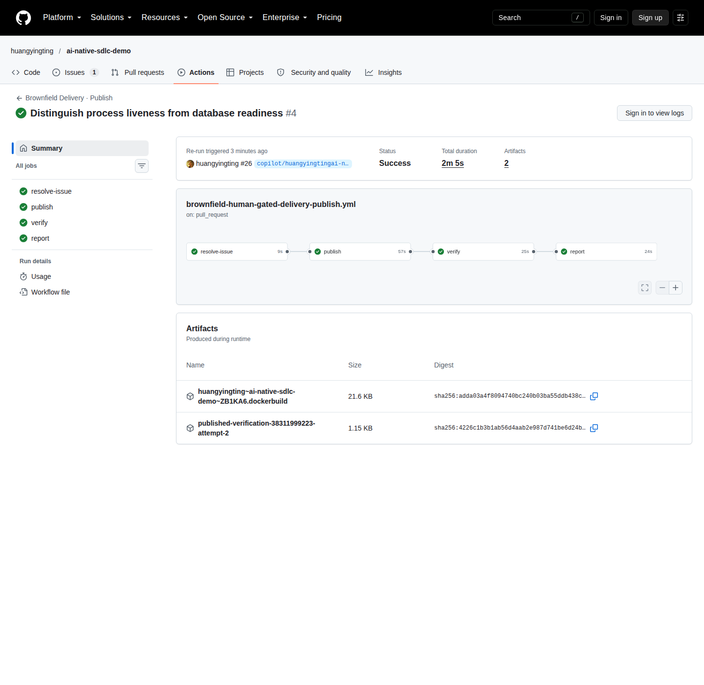

三个初始角色运行同一摘要：使用独立卷的健康对照、使用已填充保留卷的实例，
以及无挂载的无效路径实例。对照在重启和交接期间保持就绪。
修复实例挂载保留卷之前，先停止并移除此前使用该卷的实例，避免并发访问。

| 观察 | 结果 |
| --- | --- |
| 无效配置 | 存活检查 200；就绪检查 503，正文精确为 `{"status":"unavailable"}` |
| 修正配置后重建 | 就绪检查 200；列表和详情可读 |
| 已填充存储的重启与修复 | 四条原始记录及精确时间戳全部不变 |
| 已初始化空表 | 不重新播种也能就绪，重启后仍为空 |
| 热查询故障 | 同一个已发布进程中从就绪到不可用再到就绪；GET、HEAD 和固定脱敏事件均验证 |
| 输入与方法 | 忽略真实 HTTP GET 正文和查询覆盖值；其他指定方法不初始化数据库 |


### 保留真实用户操作，不只验证探测响应

通过浏览器提交创建了未分配工单，
并在四种状态中分别验证分配给 Alex Chen、转交给 Sam Rivera 和清空负责人，
共 **12 项负责人检查**。
状态更新、无效创建及负责人和状态输入、未变化负责人提交的时间戳，
以及**七项筛选检查**均通过。
无效状态保留原有 500 错误行为，数据库没有改变。

四条原始工单从未编辑；有意变更只影响新建的合成演示工单。
重复的 GET、HEAD 就绪请求保留了全部五条记录及时间戳。

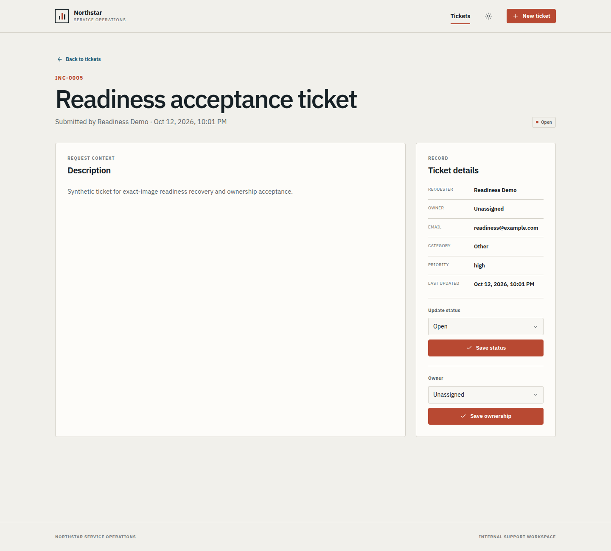


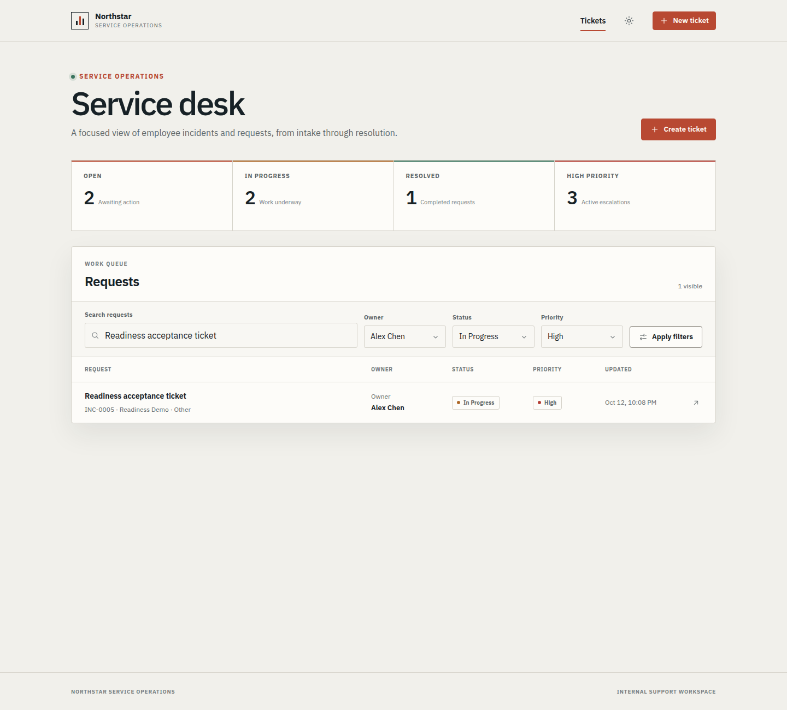

集成浏览器的显示截图和后台动画帧轮询不可用。
实际 DOM 提交与定时轮询配合持久化界面和数据库检查，独立无头浏览器截图记录持久页面。
没有在未核对持久状态的情况下，把导航中止事件当作成功写入。

全部七个任务容器和三个一次性卷均已移除。
私有工单对照和原始日志未公开。
21 张原始截图的时间、来源身份、尺寸和哈希保存在
[校验清单](assets/readiness/manifest.json)中。

## 7. 验收产物，不用实现批准替代验收

[证据汇总](https://github.com/huangyingting/ai-native-sdlc-demo/issues/18#issuecomment-6133700328)
供用户确认后，才记录
[显式最终验收](https://github.com/huangyingting/ai-native-sdlc-demo/issues/18#issuecomment-6133959987)。
[可信回执](https://github.com/huangyingting/ai-native-sdlc-demo/issues/18#issuecomment-6133963982)
和[已验收状态](https://github.com/huangyingting/ai-native-sdlc-demo/blob/b65448cded63331bfab37e5c9c35e8fcd461294b/docs/delivery-runs/brownfield-human-gated-delivery/18/run-state.json)
把摘要绑定到发布运行 `38311999223` 第 2 次执行。
需求只在该关卡之后关闭，不会因单元测试、合并或自动镜像验证而提前关闭。

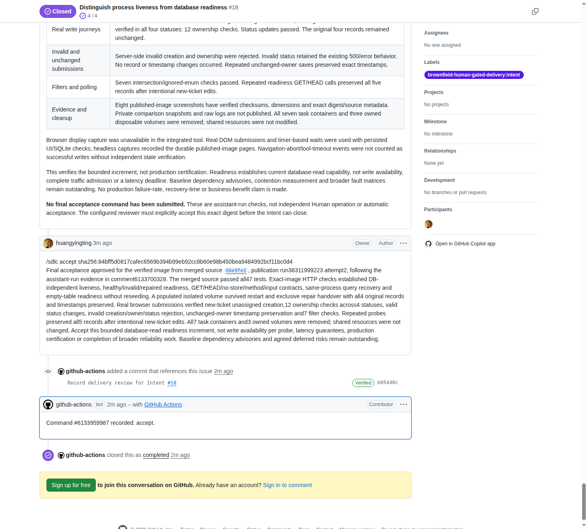

**边界仍在：**就绪检查只证明当前数据库可读，
不证明可写、完整应用流程、认证、响应时限或足以允许生产流量。
基线依赖风险、锁竞争测量、其他故障矩阵和预防性维护仍待跟进。
没有声称改善了生产故障率、投入回报或恢复时间。
