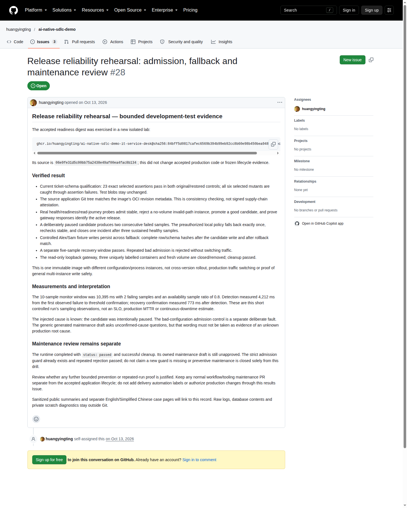

# Release reliability: reject, detect and recover

[中文](reliability.md) · [Case index](README.en.md) · [Readiness prerequisite](readiness.en.md)

**Deterministic engineering appendix, not autonomous AI recovery.** This
rehearsal adds no Copilot CLI diagnosis or repair call. Fixed scripts perform
qualification, fault injection, monitoring and fallback against the previously
delivered image. See [demo goals and Copilot's role](../copilot-roles.en.md).

## Result and boundary

Two separately recorded, fresh-volume development-test rehearsals passed.
Each rejected an unhealthy candidate, promoted a healthy candidate, detected
an intentionally paused process and fell back exactly once to the stable
instance. Both preserved the candidate's controlled database write.

This is **operational recovery evidence**, not a new production release,
code-repair acceptance, an SLO or completed preventive maintenance.
[Results and maintenance review](https://github.com/huangyingting/ai-native-sdlc-demo/issues/28)
remain an ordinary review record, not a Human-Gated Delivery approval.



The screenshot records the first rehearsal at capture time. The subsequent
independent repetition is preserved in the [two-run evidence](assets/reliability/replication.json).
[Screenshot provenance](assets/reliability/manifest.json) preserves the original bytes.

## What was qualified

The [accepted readiness image](readiness.en.md) is pinned to:

```text
ghcr.io/huangyingting/ai-native-sdlc-demo-it-service-desk@sha256:84bff5d0817cafec6569b394b99eb92cc8b60e98b450bea9484992bcf11bc0d4
```

Its OCI revision is `06e9fe31d5c00bb75a2438e49af00ea4fac8b134`.
Qualification uses that exact source application tree, not a later documentation
commit whose application tree differs. The selected
`ticket-schema-readiness-v1` profile requires **23 exact assertions**:
six route assertions, sixteen store assertions and one liveness assertion.
These are a focused subset, not the complete 47-test application suite.
Baseline and restored final control both passed 23/23; test blobs stayed unchanged.

| Deliberate mutation | Detection |
|---|---|
| Skip the actual ticket-schema read | Assertion failure |
| Return 200 for a failed dependency probe | Assertion failure |
| Omit `no-store` on success | Assertion failure |
| Omit `no-store` on failure | Assertion failure |
| Log the raw dependency error | Assertion failure |
| Cache a successful readiness result | Assertion failure |

All six were killed by assertions, not import failures, missing suites or
infrastructure errors. The [first-run summary](assets/reliability/summary.json)
preserves qualification identifiers and restored-source checks.

## The actual rehearsal

```text
Stable instance + fresh fixture volume
    → reject bad configuration with no volume
    → admit healthy candidate and prove gateway selection
    → controlled candidate write
    → pause candidate before sample 3
    → two failed samples → one fallback
    → sustained stable health → resolved incident
    → unpause candidate → independent recovery window
    → reject bad configuration again → clean resources
```

Stable and healthy candidate use the **same immutable image** and one new
fixture volume per rehearsal. The bad database-path instance has no volume.
The gateway exposes only read traffic on loopback; explicit fixture writes
use the qualified Alex Chen / Sam Rivera roster.

The selected-release gateway response, not merely a healthy candidate's direct
endpoint, proves promotion and fallback. A real controlled write is observed
before the candidate is paused. Complete row/schema hashes after that write
and after rollback match in each run; the earlier hash differs.

## Measured observations

| Measure | Run 1 | Run 2 |
|---|---:|---:|
| Monitor samples | 10 | 10 |
| Healthy / failed samples | 8 / 2 | 8 / 2 |
| Short-window healthy ratio | 0.8 | 0.8 |
| Detection after first failed observation | 4,212 ms | 4,210 ms |
| Recovery confirmation after incident opening | 773 ms | 793 ms |
| Sampled incident span | 4,985 ms | 5,003 ms |
| Fallbacks / resolved incidents | 1 / 1 | 1 / 1 |
| Separate healthy recovery samples | 5 | 5 |
| Repeated bad admission rejected | Yes | Yes |
| Containers / fresh volumes cleaned | 3 / 1 | 3 / 1 |

Runs have distinct incident/evidence IDs and fresh volumes; run 2 is an explicit
replication, not a hidden retry or overwrite. The sampled span is **not
continuous downtime**, and these numbers are neither production MTTR nor an SLO.
Probe timeouts contribute to the observed detection interval.

## Maintenance is still a review gate

The cause here is known: the operator deliberately paused the candidate.
The strict admission guard already exists and rejected the bad configuration
before and after recovery in both runs.

The automatically generated maintenance draft is **unapproved**. Its generic
“cause unconfirmed” and “implement missing guard” wording cannot be adopted as
this experiment's factual diagnosis. Review the known injection, existing guard,
ownership and any justified follow-up before starting a new delivery. Service
recovery does not itself approve a maintenance Spec or close preventive work.

## What this does not prove

- No cross-version rollout, schema migration rollback or production canary was tested.
- A read-only gateway and controlled writes do not establish general concurrent-write safety.
- Short bounded samples do not certify long-term availability or readiness lock deadlines.
- The eight baseline dependency advisories remain; the accepted feature is not production certification.
- All rehearsal containers, fresh volumes and loopback gateways were cleaned; screenshot addresses are not live deployments.

## Present or repeat it

Show admission rejection first, then gateway selection, the two failure
observations, one fallback and the preserved write hash. Finish with the
maintenance-review boundary rather than claiming automatic prevention.

Use the [reusable reliability guide](https://github.com/huangyingting/ai-native-sdlc/blob/main/docs/guides/brownfield-reliability-loops.en.md)
for operator commands and safety requirements. A read-only presentation uses
the committed evidence and does not need another fault injection.
